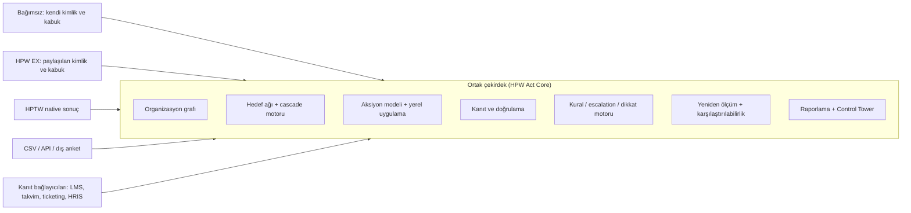
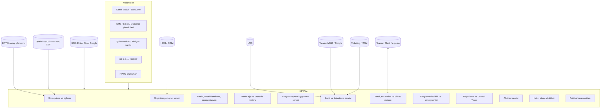
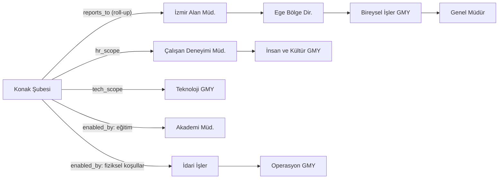
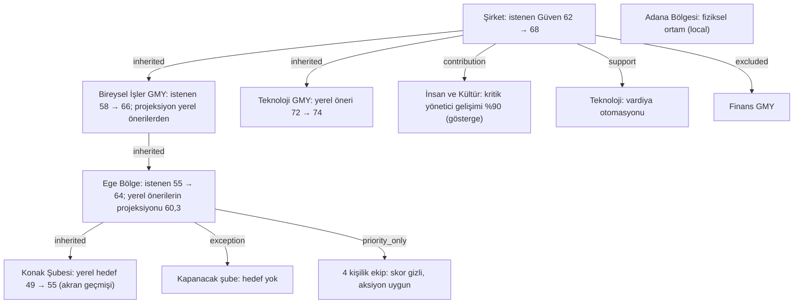
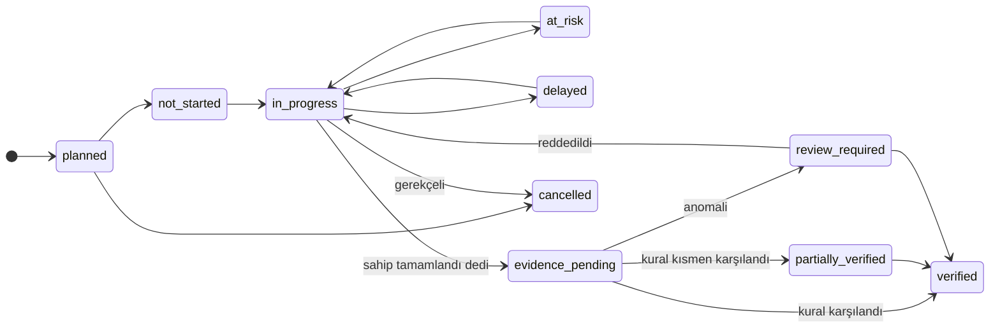
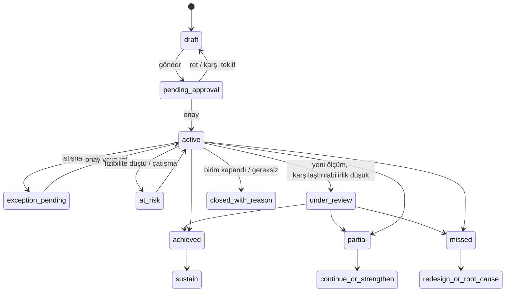
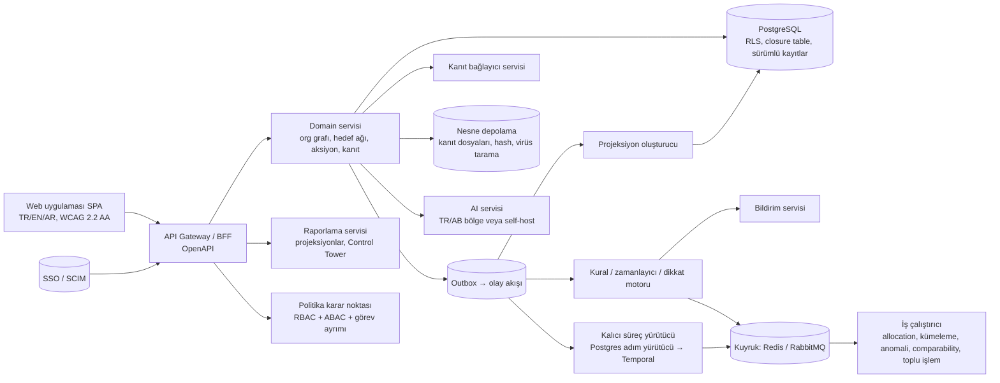

# HPW Act — Employee Experience Execution Platform
## Mimari Tasarım v2.3 — kanonik sürüm (tek algoritma, tek belge)


*Sürüm: v2.4 — 24 Eylül 2026. v2.3.1, v2.3, v2.2 ve öncekilerin yerine geçer; v2.4 takip birimini boyuttan MADDEYE taşır ve anket-agnostik enstrüman modelini, sonuç paketi formatını ve sorumluluk merkezini getirir (bölüm 6.0, ADR-0039..0041); v2.3.1 inceleme raporunun kabul edilen bulgularını (karar çekirdeği düzeltmeleri, sözleşme birleştirme, çelişkili bölümlerin yeniden yazımı; docs/reviews/2026-09-23-v23-inceleme-yaniti.md) işler. Bu belge kanoniktir: eski dağıtım (allocation) ve öncelik formülleri kaldırılmıştır; "çelişirse bölüm X kazanır" ifadesi yoktur. Girdi: v2.1 üretim sertleştirme katmanı, v2.2 semantik kilit (üretim dayanıklılığı değerlendirmesi) ve v2.3 red-team/torture-test raporunun kabul edilen bölümleri (ADR-0017..0032). Değişmez sözleşme: kurumsal ambition kota değildir; yerel hedef yalnız yerel veriden ve metodolojik fizibiliteden üretilir, ambition yerel hedef algoritmasına girdi olmaz; katkı projeksiyonu hedef değildir; kurumsal seçim birimin ciddi yerel sorununu silemez; gizli birim için sayısal hiçbir çıktı üretilemez; çalışan hedef, aksiyon ya da kanıt sahibi olmaz, sahip organizasyonel roldür; tamamlandı ≠ doğrulandı ≠ sonuç iyileşti ≠ bu aksiyon nedeniyle iyileşti; normal olanı sistem yürütür, insan yalnız istisnayı yönetir.*

> **v3.0 notu (08.11.2026, ADR-0043).** Ürün sadeleştirildi: HPW Act artık rapordaki yol haritasının takip aracıdır (kurum + işletme katmanı, plan = tek anket maddesi, adım durumu ikili). Bu belgedeki hedef ağı, uzlaştırma, istisna, kanıt, dikkat kuyruğu ve yapay zekâ bölümleri kapalı modüller içinde geçerlidir; kod ve tablolar durur, üretimde kapalıdır. **Yapay zekâ şimdilik kapalıdır; bağlantı noktası korunuyor** (R-02). Güncel karar kaydı: `docs/adr/ADR-0043-sade-hpw-act-v3.md`.

---

## 0. Yönetici özeti

v1, tek bir departmanın kendi hedefini yönetmesi için doğru kurulmuştu: Sonuç → Hedef → Aksiyon → Sonuç Değerlendirme zinciri, versiyonlu ve onaylı Hedef nesnesi, gizlilik eşiği ve roll-up, gecikme escalation'ı, çok kiracılı teknik altyapı. Atlas Holding senaryosu (12 GMY, 18 bölge, 400 şube, 35 müdürlük, 32.000 çalışan, matris organizasyon, aynı dönemde reorg, işten ayrılma, izin, çelişen hedefler, kanıt sahteciliği, karşılaştırılamayan ölçüm) bu tasarımı üç yerde kırıyordu: organizasyon bir ağaç değil ağdı, hedefler birbirine bağlı bir ağ oluşturuyordu ve "tamamlandı" beyanı ile gerçek etki aynı sayıya sıkıştırılmıştı.

v2 bu üç kırılmayı domain düzeyinde çözer ve eleştirilerdeki diğer eksikleri (merkez aksiyonu ile yerel uygulama ayrımı, kanıt doğrulama merdiveni, anti-gaming, reorg lineage, karşılaştırılabilirlik değerlendirmesi, istisna müzakeresi, kapasite, dikkat kuyruğu, toplu işlemler, vekâlet, sahipsiz kalan iş, çok ülke/saat dilimi, hedef çatışması, yerel sorunların kurumsal aksiyona kümelenmesi) ayrı bileşenler olarak ekler. Değişmeyen çekirdek: sonuç alma ve normalizasyon, Hedef'in merkezi konumu, gizlilik mantığı, escalation merdiveni, etkinlik bilgi tabanı, teknik altyapı.

v2.1'in getirdiği katman şudur. Hedef matematiği dönem başında dondurulan bir kohort üzerinde çalışır; baseline'ı olmayan birim paydaya girmez (v2'deki `t_i = b_i` hatası kapatıldı); bir birim üst hedefe yalnızca bir kanonik kenardan sayılır (çift sayım veritabanı kısıtıyla imkânsız); sorumluluk payları ayrı bir nesnede tutulur ve skor matematiğine girmez; her cascade koşusu algoritma sürümüyle yeniden üretilebilir. Uzun ömürlü süreçler (istisna müzakeresi, reorg devri, kanıt incelemesi) kalıcı süreç örnekleri olarak çökmeye dayanıklıdır; her komut beklenen sürüm ve kimlik taşır, her olay tekilleştirilir. Yetkilendirme rol + öznitelik tabanlıdır ve görev ayrımı sert kuraldır. Yüksek erişilebilirlik, bozulma matrisi, tenant kaynak kotaları, veri yaşam döngüsü (saklama, yasal tutma, silme, anonimleştirme, aktarım sicili) ve hizmet hedefleri açıkça tanımlıdır. Kaynak gereksinimi ve taahhüdü modele girdi; çevrimdışı istemci ve ERP bağlayıcısı ise komut zarfı ve kaynak nesneleri hazır olduğu için müşteri talebine bırakıldı.

Mimarinin özü şu cümlelerle özetlenebilir. Organizasyon bir graftır; skor tek bir hiyerarşi boyunca toplanır, sorumluluk birden çok ilişki boyunca dağılır. Hedefler bir ağ oluşturur; her hedefin nereden geldiği, üst hedefe ne kadar katkı verdiği ve istisnası olup olmadığı veri modelinin parçasıdır; kurumsal hedef alt hedeflerin ağırlıklı toplamıyla kısıtlanır. Aksiyon birden çok hedefe katkı verir; merkezden açılan aksiyon bir "ana aksiyon"dur ve her birimde ayrı bir "yerel uygulama" olarak izlenir. Bir aksiyonun uygulama durumu ile etki durumu iki ayrı eksendir ve hiçbir zaman tek yüzdeye indirgenmez; "tamamlandı" bir beyandır, kanıt merdivenindeki ilk basamaktır. Yeni ölçüm geldiğinde hedef tutup tutmadığından önce iki ölçümün karşılaştırılabilir olup olmadığı değerlendirilir. Tarih yeniden yazılmaz: reorg olayları, hedef sürümleri, kanıt kararları ve sahiplik değişimleri lineage ve audit olarak kalır. Kullanıcı metodoloji bilmez; sistem analiz eder, önerir, seçenek sunar; kullanıcı seçer, AI karar vermez. Merkezi yönetim panel okumaz, dikkat kuyruğu işler.

Bu belgede kullanıcının onaylaması gereken kararlar 23. bölümde toplanmıştır; kabul senaryosunun ve eleştirilerin her maddesinin hangi bileşenle karşılandığı 21. bölümdeki izlenebilirlik matrisinde, sürüm kapısı olarak kullanılacak testler 22. bölümde gösterilmiştir.

---

## 1. Tasarım ilkeleri (aksiyomlar)

Aşağıdaki on bir ilke, her mimari kararın test edildiği kurallardır. Bir bileşen bunlardan birini ihlal ediyorsa bileşen yanlıştır.

1. **Organizasyon bir ağdır, ağaç değil.** Bir birimin idari üstü, fonksiyonel üstü, İK kapsamı, teknoloji kapsamı ve anket raporlama kapsamı farklı olabilir. Ancak her ölçüm döneminde skorların toplandığı tam olarak bir hiyerarşi vardır (roll-up hiyerarşisi); diğer ilişkiler sorumluluk içindir, toplama için değil.
2. **Beş ayrı gerçek vardır:** Sonuç (çalışan ne dedi), Hedef (ne değişmeli), Aksiyon (ne yapılacak), Uygulama (yapıldı mı), Etki (değişti mi). Hiçbiri diğerinden türetilmez ve hiçbiri diğerinin yerine raporlanmaz.
3. **Hedef bir ağın düğümüdür.** Her hedefin kaynağı (miras, katkı, destek, yerel, ortak, istisna), üst hedefe katkı payı ve değişiklik gerekçesi vardır. Üst hedef alt hedeflerin ağırlıklı toplamıyla kısıtlıdır; serbest bir sayı değildir.
4. **Aksiyon çoğa bağlıdır.** Bir aksiyon birden çok hedefe katkı verir; bir hedef birden çok aksiyonla desteklenir. Merkezden açılan aksiyon ana aksiyondur; her birimdeki uygulaması ayrı izlenir, ana aksiyon hiçbir zaman tek bir "tamamlandı" durumu almaz.
5. **"Tamamlandı" bir beyandır.** Uygulama ancak kanıt gereksinimi karşılanınca doğrulanır; kanıt türü aksiyon açılırken belirlenir; anomali gösteren kanıt incelemeye düşer, otomatik reddedilmez.
6. **Karşılaştırılamayan ölçüm hedef tutturmaz.** İki ölçüm arasındaki yanıt sayısı, madde sürümü, nüfus devamlılığı ve organizasyon değişikliği önce değerlendirilir; hedef başarısı bu değerlendirmenin sonucuyla birlikte raporlanır.
7. **Gizlilik skoru gizler, katkıyı engellemez.** Yanıt sayısı eşiğin altındaki birim skorunu görmez ama üst birimin önceliğine bağlanır, önerilen aksiyonları alır ve yerel uygulama birimi olarak izlenir.
8. **Tarih yeniden yazılmaz.** Reorg olayları lineage olarak, hedef değişiklikleri sürüm olarak, kararlar audit olarak kalır; geçmiş dönem her zaman o dönemin organizasyonu ve sorumlusuyla görüntülenebilir.
9. **Kullanıcı metodoloji bilmez.** Boş form yoktur; sistem analiz eder, en fazla üç seçenek sunar, kullanıcı kabul eder, değiştirir veya nedenini seçerek reddeder; sistem alternatif üretir.
10. **AI önerir, insan karar verir.** Hedef koyma, hedef kapatma, kanıt reddetme, sahip atama ve istisna onayı her zaman insan kararıdır; AI bu kararlar için seçenek ve gerekçe üretir.
11. **Sistem dikkat yönetir, rapor değil.** Her rol için giriş ekranı "bugün karar gerektiren konular" listesidir; dashboard bu kuyruğun arkasındaki bağlamdır.
12. **Hedef matematiği dondurulmuş kohort üzerinde çalışır.** Bir üst hedefin hangi birimler, ağırlıklar ve baseline'larla kurulduğu dönem başında dondurulur; organizasyon değişti diye çıta sessizce yer değiştirmez. Bir birim üst hedefe yalnızca bir kanonik kenardan sayılır; sorumluluk payı skor matematiğine hiçbir zaman girmez.
13. **Süreç durumu kalıcıdır, her komut ve olay tekildir.** Dokuz ay yaşayan bir hedefin süreci çökme, yeniden başlatma ve tekrar teslimattan etkilenmez; her komut beklenen sürüm ve kimlik taşır; her olay en az bir kez teslim edilir ama iş etkisi en fazla bir kez uygulanır; hiçbir tenant diğerinin kaynağını tüketemez.

---

## 2. Ürün sınırı ve konumlandırma

Kategori: **Employee Experience Execution Platform** — çalışan deneyimi verisini organizasyon çapında ölçülebilir değişime dönüştüren yürütme sistemi. Kısa ürün adı önerisi: **HPW Act**.

Ürün anket yapmaz; anket sonuçları HPTW'den (native) veya başka kaynaklardan (Qualtrics, Culture Amp, CSV, API) alınır. Ürün performans değerlendirmesi, bireysel OKR, maaş, LMS, tanıma-ödül ve proje yönetimi aracı değildir; OKR ve strateji-yürütme araçlarından yalnızca desen (check-in ritmi, confidence, roll-up, dikkat kuyruğu) alır. Kapasite yönetimi bir modül değil, sistemdeki atamalardan türetilen bir göstergedir; yöneticilerden müsaitlik girmeleri istenmez.

İki kurulum biçimi aynı çekirdeği kullanır. **Bağımsız SaaS**: kendi kimlik, tenant ve kabuğuyla, survey-agnostic. **HPW EX modülü**: HPW Employee Experience platformunun kimliğini, rol modelini (Super Admin, Platform Admin, EX Program Direktörü, Danışman, Metodolog, Veri Analisti, Rapor Tasarımcısı, Denetçi + Executive, HR Admin, HRBP, Line Manager, Viewer) ve sonuç verisini doğrudan kullanır. Çekirdek — domain modeli, organizasyon grafı, cascade motoru, kural/dikkat motoru, kanıt sistemi, raporlama — her iki biçimde aynıdır ve kimlik ile sonuç alma katmanlarından arayüzlerle ayrılmıştır.



---

## 3. Kavramsal model ve terminoloji sözlüğü

| Türkçe | İngilizce | Tanım |
|---|---|---|
| Hiyerarşi grubu | Hierarchy Group | Bir organizasyon görünümü (idari, fonksiyonel, coğrafi, İK kapsamı). Dönem başına biri roll-up hiyerarşisi olarak işaretlenir. |
| Organizasyon ilişkisi | OrgRelationship | İki birim arasında tipli, tarihli kenar: reports_to, functional_to, geographic_to, hr_scope, finance_scope, survey_reporting_scope, enables. |
| Sorumluluk haritası | Responsibility Map | Konu/kaldıraç → hesap veren birim + destekleyen birimler eşlemesi. "Vardiya planlaması → Operasyon Planlama Müd." |
| Etkilenen / hesap veren / destekleyen birim | Affected / Accountable / Enabling Unit | Sorunun görüldüğü birim, sonuçtan sorumlu birim, çözüm için gerekli destek birimi. |
| Reorg olayı, soy ağacı | ReorganizationEvent, OrgLineage | Birim yeniden adlandırma, taşıma, bölünme, birleşme, kapanma, açılma kaydı ve birimler arası "türedi" bağı. |
| Vekâlet | Delegation | Bir kişinin sorumluluklarının belirli süre ve kapsamda başka kişiye devri (izin, boşluk). |
| Ölçüm dönemi | Survey Cycle | Anket dalgası; sonuç, hedef ve karşılaştırma bağlamı. |
| Madde kataloğu (sürümlü) | Item Catalog | Anket maddeleri ve boyutları, ifade sürümleriyle; madde soy ağacı karşılaştırılabilirlik için tutulur. |
| Sonuç | Result | Birim × madde/boyut × dönem; n, yanıt oranı, baskılanmış bayrağı, roll-up kaynağı. |
| Odak alanı | Focus Area | Bir birim için çalışılmaya seçilen boyut. |
| Hedef | Target | Sayısal hedef skor + tarih + sahip + onay; ağın düğümü. |
| Hedef ilişkisi | TargetRelationship | Üst–alt hedef bağı: türü (miras, katkı, destek, yerel, ortak, istisna), katkı ağırlığı, gerekçe, onay. |
| Cascade / katkı motoru | Cascade & Contribution Engine | Üst hedefi alt birimlere ağırlıklı, baseline'a duyarlı ve fizibilite kontrollü dağıtan; alt hedefleri üste toplayan motor. |
| İstisna talebi | Exception Request | Alt birimin hedefi düşürme, erteleme veya muaf olma müzakeresi. |
| Hedef çatışması | Target Conflict | Aynı birimde ters yönlü kaldıraçlara bağlı iki aktif hedef. |
| Ana aksiyon / dağıtım / yerel uygulama | Master Action / Deployment / Local Execution | Merkezden açılan aksiyon, hangi birimlere dağıtıldığı ve her birimdeki bağımsız yürütme kaydı. |
| Aksiyon katkısı | ActionContribution | Aksiyon ↔ Hedef çoktan çoğa bağı ve ağırlığı. |
| Aksiyon katılımcısı | ActionParticipant | Aksiyonda kişinin/birimin rolü: accountable, responsible, contributor, verifier, enabler, informed. |
| Bağımlılık | Dependency | Aksiyonun başka aksiyona veya birime bağlı olması. |
| Sorun escalation'ı, sorun kümesi | Problem Escalation, Issue Cluster | "Kontrolüm dışında" ile merkeze taşınan sorun ve benzerlerinin otomatik kümelenmesi. |
| Kanıt gereksinimi | Evidence Requirement | Aksiyon açılırken şablondan gelen doğrulama kuralı: tür, seviye, beklenen adet/süre, kaynak. |
| Kanıt merdiveni | Evidence Ladder | Beyan → Yüklendi → Doğrulandı → Öncü KPI teyit → Sonuç teyit. |
| Kanıt güveni | Evidence Confidence | Kanıt setinin türü, doğrulaması ve anomali sinyallerinden türetilen Yüksek/Orta/Düşük. |
| Uygulama durumu / Etki durumu | Execution Status / Impact Status | Aksiyonun iki bağımsız ekseni. |
| Karşılaştırılabilirlik değerlendirmesi | Comparability Assessment | Baseline ile takip ölçümünün kıyaslanabilirlik derecesi ve doğrulama durumu. |
| Sonuç değerlendirme | Outcome | Hedefin yeni ölçümdeki başarısı, hareket sınıfı, dış faktörler ve karar. |
| Dikkat öğesi | Attention Item | Bir rolün karar vermesi gereken, durumu ve SLA'sı olan iş. |
| Kapasite göstergesi | Workload Index | Kişinin açık sahipliklerinden türetilen yük seviyesi. |
| Etkinlik bilgi tabanı | Effectiveness Knowledge Base | Aksiyon şablonu → gözlenen skor hareketi, başarı oranı, etkiye kadar süre (karşılaştırılabilir ölçümlerden). |
| Hedef kohortu | TargetCohort | Bir hedefin kurulduğu birim kümesi, dondurulmuş ağırlıklar ve baseline'lar; politikalar: BASELINE_FROZEN, CURRENT_ORG_DYNAMIC, LINEAGE_ADJUSTED. |
| Uzlaştırma koşusu | TargetReconciliationRun | Bir cascade hesabının algoritma sürümü, girdi özeti ve sonucuyla yeniden üretilebilir kaydı. |
| Sorumluluk tahsisi | ResponsibilityAllocation | Hedef/aksiyon üzerinde birimlerin rolü, payı ve karar yetkisi; skor matematiğinden ayrı. |
| Kaynak gereksinimi / taahhüdü | ResourceRequirement / ResourceCommitment | Aksiyonun istediği bütçe, kadro, tedarikçi, varlık; fiilen taahhüt edilen miktar ve onay durumu. |
| Süreç örneği | WorkflowInstance | Uzun ömürlü bir iş sürecinin (istisna müzakeresi, reorg devri, kanıt incelemesi) kalıcı durumu, adımları, zamanlayıcıları ve olayları. |
| Komut zarfı | Command Envelope | Her yazma isteğinin taşıdığı command_id, expected_version, correlation_id, causation_id, actor, acting_for. |
| Görev ayrımı | Separation of Duties | Aynı kişinin talep edip onaylamasını, yükleyip doğrulamasını engelleyen sert politika. |
| Politika karar noktası | Policy Decision Point | Rol, birim, ilişki türü, dönem, vekâlet ve nesne özniteliklerini birlikte değerlendiren yetkilendirme servisi (RBAC+ABAC). |
| Veri yaşam döngüsü | Data Lifecycle | Saklama politikası, yasal tutma, silme talebi, anonimleştirme işi, aktarım sicili. |

---

## 4. Sistem bağlamı ve bileşen mimarisi



Servisler tek bir modüler monolit içinde sınırları belirgin modüller olarak başlar (ayrı süreç değil); yük ve ekip büyüdüğünde kural/zamanlayıcı, kanıt doğrulama ve AI servisleri ayrılabilir. Modüller arasında iletişim domain olayları üzerinden yapılır (outbox deseni); bu, audit, lineage ve dikkat kuyruğunun tek bir olay akışından beslenmesini sağlar.

---

## 5. Organizasyon modeli: ağ, sorumluluk haritası, reorg soy ağacı

### 5.1 Hiyerarşi grupları ve ilişkiler

Bir birim (OrgUnit) tek bir parent_id taşımaz. Birimler arasında tipli ve tarihli kenarlar (OrgRelationship) vardır ve kenarlar hiyerarşi gruplarına (HierarchyGroup) aittir. Tenant en az bir hiyerarşi grubu tanımlar; Atlas Holding için tipik kurulum: *İdari* (reports_to), *Fonksiyonel* (functional_to), *Coğrafi* (geographic_to), *İK kapsamı* (hr_scope), *Teknoloji kapsamı* (tech_scope). Her ölçüm döneminde bu gruplardan tam olarak biri **roll-up hiyerarşisi** olarak işaretlenir; sonuçların toplanması, baseline'ların hesaplanması ve miras türü hedef katkılarının roll-up'ı yalnızca bu grup boyunca yapılır. Diğer gruplar sahiplik, görünürlük ve destek ilişkilerini belirler; hiçbir zaman toplama yolu değildir. Bu kural çift sayımı ve "bu şube kime roll-up olacak" belirsizliğini ortadan kaldırır.

İzmir Konak Şubesi örneği:



### 5.2 Sorumluluk haritası ve üç birim rolü

Sorumluluk haritası (ResponsibilityMap) konu bazında hesap veren ve destekleyen birimleri tanımlar: satır = kapsam (tüm organizasyon veya bir alt ağaç) × konu (boyut, madde veya kaldıraç etiketi, örneğin *vardiya planlaması*, *eğitim*, *fiziksel koşullar*, *ücret politikası*, *yönetici davranışı*) → hesap veren birim, destekleyen birimler, yetki düzeyi (karar/öneri). Harita başlangıçta HR Admin tarafından kurulur, sonra sorun escalation'larından öğrenir: bir konu için kullanıcıların önerdiği sahipler istatistiksel olarak birikince sistem haritayı güncellemeyi önerir.

Sorumluluk haritası varsayılan kaynaktır; belirli bir hedef veya aksiyon üzerinde fiilen kimin ne kadar sorumlu olduğu ise ResponsibilityAllocation ile tutulur: birim, rol (accountable, responsible, enabler, contributor), sorumluluk payı (örneğin Operasyon %40, Teknoloji %35, şube %25), karar yetkisi ve geçerlilik tarihleri. Bu paylar görev dağılımı, kaynak tahsisi, hesap verebilirlik ve "neden ben?" açıklaması için kullanılır; anket skorunun roll-up ağırlıklarına hiçbir zaman girmez. Teknoloji'nin çözümde %35 sorumlu olması, Teknoloji GMY skorunun şirket skoruna %35 ağırlıkla girmesi demek değildir; skor tek kanonik hiyerarşiden gelir, sorumluluk ayrı graf üzerinde çalışır.

Her sorun için sistem üç birim hesaplar. **Etkilenen birim** skorun düşük olduğu birimdir. **Hesap veren birim** sorunun kaldıracını kontrol eden birimdir; yönetici davranışına bağlı konularda varsayılan olarak etkilenen birimin kendisi, merkezi politikaya bağlı konularda haritadaki birim. **Destekleyen birimler** haritada listelenen birimlerdir. Bu üçlü, hedefin hangi seviyeye konacağını ve aksiyonun kime önerileceğini belirler.

### 5.3 Reorg olayları ve soy ağacı

Birimler effective-dated tutulur (effective_from, effective_to) ve her yapısal değişiklik bir ReorganizationEvent olarak kaydedilir: `rename`, `move` (üst değişimi), `split` (bir birim → n birim), `merge` (n birim → bir birim), `close`, `open`, `absorb` (iştirakin ana şirkete bağlanması). Olay, kaynak ve hedef birimleri, geçerlilik tarihini ve varsa çalışan eşleme kuralını (HRIS'ten hangi çalışan hangi yeni birime gitti) taşır. OrgLineage, olaylardan türetilen "türedi" kenarlarıdır. Geçmiş dönemin sonuçları, hedefleri ve sorumluları eski birime bağlı kalır; sistem herhangi bir tarih için o tarihteki organizasyonu yeniden kurabilir.

Olay türüne göre otomatik davranış:

| Olay | Sonuç ve baseline | Hedefler | Aksiyonlar ve yerel uygulamalar | Sahiplik |
|---|---|---|---|---|
| rename | Değişmez | Değişmez | Değişmez | Değişmez |
| move | Değişmez; roll-up yeni yolda | Birim hedefi birimi izler; üst hedef ilişkisi yeni üste yeniden bağlanır, eski ilişki tarihçede kalır; üst hedeflerin fizibilitesi yeniden hesaplanır | İzler | Yeni üst yöneticiye "devralınan hedef" dikkat öğesi |
| split | Yanıt düzeyi veri varsa çalışan eşlemesiyle türetilmiş baseline; yoksa üst birim baseline'ı vekil olarak, `baseline_derived` bayrağı ve düşük karşılaştırılabilirlik | Hedef kopyalanmaz; her yeni birime lineage notuyla yeni öneri üretilir, eski hedef "bölünmeyle kapatıldı" olarak tarihçede | Yerel uygulamalar yeni birimlere dağıtılır (ana aksiyon değişmez) | Her yeni birimin sahibi için devir akışı |
| merge | Kaynak birimlerin n ile ağırlıklı baseline'ı; `baseline_derived` | Kaynak hedefler tarihçeye; birleşik birim için konsolide öneri (ağırlıklı) sahibin onayına | Yerel uygulamalar birleşir; çakışan aksiyonlar tekilleştirme önerisiyle | Devir akışı |
| close | Sonuçlar arşiv | Hedef "birim kapandı" gerekçesiyle kapatılır; üst hedef fizibilitesi yeniden hesaplanır | Yerel uygulamalar iptal (lineage notu) | Sahipsiz kalan iş kuyruğuna |
| open | `baseline_missing` statüsü; gelişim hesabında ayrı kategori | Yerel sayısal hedef yok; üst birimin önceliğine bağlanır, aksiyon alabilir | Üst birimin ana aksiyonlarına yerel uygulama olarak eklenir | Sahip atanır |
| absorb | İştirak baseline'ı korunur, roll-up yeni yolda | move gibi | move gibi | move gibi |

Kurumsal hedefin katkı hesabı hedef kohortu politikasına göre iki görünümde sunulur: taahhüt görünümü dönem başında dondurulmuş kohortla (BASELINE_FROZEN) hesaplanır ve organizasyon değişti diye çıta yer değiştirmez; operasyonel görünüm bugünkü organizasyonla (CURRENT_ORG_DYNAMIC) hesaplanır; split/merge sonrası kohort lineage üzerinden yeniden ağırlıklandırılır (LINEAGE_ADJUSTED). İki görünüm de aynı olay kaydından türetildiği için tutarlıdır.

Reorg uygulaması tek bir veritabanı işlemi değil, öğe bazında durumu tutulan bir süreç örneğidir (WorkflowInstance): 40 şubenin taşınması yarıda kalırsa sistem hangi 23 şubenin taşındığını, hangi hedef ilişkilerinin yeniden kurulduğunu, hangi dikkat öğelerinin üretildiğini ve hangi 17 adımın yeniden çalışacağını bilir; adımlar idempotenttir ve yeniden başlatma çift kayıt üretmez. HRIS aynı reorg olayını üç kez gönderirse olay kimliğiyle tekilleştirilir ve reorg bir kez uygulanır. HRIS'ten gelen yapısal değişiklikler otomatik uygulanmaz, HR Admin onayına düşen taslak olaylardır.

### 5.4 Vekâlet, ayrılma ve sahipsiz kalan iş

Delegation nesnesi bir kişinin sorumluluklarını belirli kapsam (tümü, belirli birim, belirli aksiyonlar) ve süre için başka kişiye devreder; izin, geçici boşluk ve vekâleten yönetim bu nesneyle temsil edilir. Bildirimler, onaylar ve check-in'ler vekile gider; audit "vekâleten" işaretiyle tutulur; süre bitince sorumluluk otomatik döner.

HRIS'ten ayrılma (deprovision) olayı geldiğinde veya birim kapandığında, kişinin sahip olduğu hedef ve aksiyonlar **sahipsiz iş kuyruğuna** (orphan queue) düşer; hedef silinmez çünkü hedef kişinin değil organizasyonel sorumluluğun hedefidir. Kuyruk, roll-up hiyerarşisindeki bir üst yöneticiye dikkat öğesi olarak gider: yeni sahip ata, kendisi üstlen, gerekçeli kapat. Yeni yönetici sisteme ilk girdiğinde "önceki yöneticiden devralınan N açık hedef ve M aksiyon" ekranını görür ve her biri için *devam ettir / yeniden değerlendir / kapatma talebi oluştur* seçer; yeniden değerlendir seçeneği hedefi taslağa alıp cascade motoruna yeniden öneri ürettirir.

Ayrılma akışının sırası sabittir: SCIM/HRIS deprovision → kişi pasif → yeni oturum engellenir → sahip olduğu hedef ve aksiyonlar keşfedilir → sahipsiz iş süreci başlar → geçici olarak accountable'a escalation → yeni sahip atanır → geçmiş kayıtlardaki aktör referansı saklama politikasına göre korunur. Kişi hiçbir adımda silinmez; "Ayşe ayrıldı, 37 aksiyonu kayboldu" sınıfındaki hata bu sırayla önlenir. Vekâlet süresi bir karar (örneğin kanıt incelemesi) devam ederken biterse yeni karar aktif yetkiliye gider, eski vekil yeni karar veremez; vekâlet çakışmaları (aynı kapsam iki vekile) kaydedilmez.

### 5.5 Çok ülke, saat dilimi ve takvim

Her birim bir zaman dilimi, çalışma takvimi (tatil, hafta sonu düzeni) ve dil taşır; kişi bunları birimden devralır, kendi dilini seçebilir. Terminler ve hatırlatmalar birimin zaman diliminde ve çalışma günlerinde hesaplanır; MENA'da Cuma–Cumartesi hafta sonu ve ülke tatilleri gecikme hesabını bozmaz.

---

## 6. Ölçüm katmanı: enstrüman, sonuç paketi, eşleme, gizlilik

### 6.0 Anket-agnostik enstrüman modeli: takip birimi MADDE (v2.4)

HPTW anketinin dört boyutu yoktur; esnek bir enstrümanı vardır. Referans enstrüman (HPTW-CBA 2026-v3): **sertifikasyon çekirdeği** her şirkette sabittir — Wellbeing Index (Başarı, Gurur, Güven; 3 × 4 madde) + Bağlılık (3 kritik madde: kalma niyeti, ekstra çaba, tavsiye — tavsiye 0–10 ölçekte, NPS de bundan üretilir) + 2 açık uçlu; **Ekosistem Teşhis Modülü** isteğe bağlıdır — 15 boyut × 4 madde, dört kategori (Çalışan İklimi ve Temel Koşullar; Liderlik ve Performans; Yetenek Sistemleri; Çalışma Modeli ve Altyapı). Şirket modül boyutlarını çıkarabilir ve kendi maddelerini ekleyebilir. Puanlama Top Box'tır (yalnız 4 ve 5); üç benchmark seti (sektör, ölçek, sertifikalı) madde ve boyut düzeyindedir.

Bu yüzden **takip birimi boyut değil maddedir.** Aynı boyutun iki maddesi bambaşka yerlere gider: Gurur boyutunda "başkalarına çalıştığım iş yerinin ismini söylemekten gurur duyuyorum" (GUR-04) işveren markasıdır ve merkezde çözülür; "gösterdiğim çabanın karşılığında hak ettiğim pozisyonlara gelebileceğime inanıyorum" (GUR-03) kariyer sistemidir; "bağlı olduğum yönetici başarılarımı görür ve takdir eder" (GUR-01) şube müdüründedir. Demo raporunda bu üç madde 93 / 61 / 60 çıkmıştır; boyut ortalaması 71,5 hepsini gizler. Öncelik, yerel hedef, aksiyon, kanıt ve sonuç yalnız `item` metriğine bağlanır (`assertTrackable`; SQL `metric_kind = 'item'` kısıtları). Boyut ve indeks türetilmiş toplamdır: görünüm, karşılaştırma ve projeksiyon için; sertifikasyon indeksi (Wellbeing Index, Bağlılık) üzerine istenen değer konabilir, o değer madde hedeflerinin resmî toplama kuralıyla projeksiyonuyla uzlaştırılır.

Her madde şu meta veriyi taşır: kod, metin (TR/EN), boyut (isteğe bağlı), ölçek (`likert5_topbox` | `likert5_mean` | `nps_0_10` | `binary` | `custom`), kutup, **etkileşim alanı** (HPTW modelindeki dört alan — işim, yöneticim, çalışma arkadaşlarım, işveren markası — ile sistem/politika, kişisel eğilim, sonuç), **sorumluluk merkezi** (`line_manager` birim yöneticisi, `team` ekip/yönetici kolaylaştırır, `hr_policy` İK politikası — ücret, yan haklar, performans sistemi, çalışma modeli —, `talent_system` yetenek ve kariyer sistemi, `central_function` merkezi fonksiyon — IT, tesis, operasyon planlama, İSG; kaldıraç etiketiyle —, `top_management` üst yönetim/kurumsal iletişim, `employer_brand` işveren markası, `outcome` sonuç, `individual` kişisel eğilim), köken (`core` | `module` | `custom`) ve kaldıraç etiketleri. Sorumluluk merkezi iki şeyi belirler: kontrol edilebilirlik (öncelik ekseni) ve **müdahaleye yetkili rol** (ADR-0037'nin iki etiketinden ikincisi); sonucu izleyen rol her zaman birimin yöneticisidir. `outcome` (Bağlılık maddeleri) ve `individual` (Yılmazlık) maddelerine hedef bağlanmaz; izleme ve sonuç alanıdır. Varsayılan eşleme domain'dedir (`rolesForItem`), tenant kurulumunda `responsibility_center_role` ile şirketin kendi rollerine bağlanır ve metodoloji ekibi tarafından gözden geçirilir.

**Sonuç paketi (hpw-act-result-bundle v1).** Sonuçlar belirli bir formatta yüklenir ve sistem enstrümanı bu paketten algılar: `manifest.json` (dönem, enstrüman kodu ve sürümü, puanlama kuralı sürümü, dil, benchmark setleri), `instrument.csv` (madde, boyut, kategori, modül, ölçek, kutup, etkileşim alanı, sorumluluk merkezi, köken, kaldıraç etiketleri, indeks üyeliği), `results_item.csv` (birim × madde: n, yanıt dağılımı `c_1..c_5` ya da `c_0..c_10`, resmî toplama ağırlığı, baskılama), `results_index.csv` (HPTW'nin resmî indeks değerleri; mutabakat için), `benchmarks.csv`. Kurallar: Top Box dağılımdan yeniden hesaplanır, pakette verilen değerle 0,15'ten fazla çelişirse paket reddedilir (T-70); enstrümanda olmayan madde, dağılım/n uyuşmazlığı, geçersiz ölçek reddedilir (T-73); n<5 birim pakette bile sayı taşımaz; resmî indeks ile madde ortalaması 0,15 içinde eşleşmezse yayımlanamaz (T-72 — T-57'nin madde düzeyi). **Algılama** (`detectInstrument`): referans enstrümana göre çıkarılan boyutlar, özel maddeler, modül sayıları, ölçekler, eksik çekirdek uyarısı; sonuç `instrument_version.detection`'a yazılır. **Panel türetme** (`derivePanels`): çıkarılan boyutun paneli kurulmaz, NPS maddesi yoksa NPS paneli yoktur, özel maddeler benchmark'sız ayrı paneldedir, sertifikasyon indeksleri kart olarak görünür, birim × madde ısı haritası ve sorumluluk merkezi haritası her enstrümanda vardır. Boyut özeti türetilmiştir ve boyut içi yayılımı gizlediği notuyla gösterilir.

### 6.1 Kaynaklar ve eşleme

Üç giriş yolu vardır: HPTW sonuç paketi (6.0; native yol), CSV/Excel şablonu (aynı sütun sözleşmesi) ve generic REST API. Dış kaynaklar madde eşlemesiyle (ItemMapping) enstrümana bağlanır; eşlenemeyen maddeler `custom` köken ve boyutsuz madde olarak saklanır, benchmark'a girmez.

Madde kataloğu **sürümlüdür**. Bir maddenin ifadesi veya ölçeği değişirse yeni sürüm oluşur ve eski sürümle denklik derecesi (identical, equivalent, changed) işaretlenir; bu bilgi karşılaştırılabilirlik değerlendirmesinin doğrudan girdisidir. HPTW kendi anketinin sahibi olduğu için native kaynakta bu bilgi kesin; dış kaynaklarda Metodolog rolü tarafından girilir.

Puanlama resmî kuralla yapılır: Top Box (`likert5_topbox`: 4 ve 5 yanıtlarının payı; `nps_0_10`: 9–10 payı) ve NPS (promotör − detraktör) dağılımdan hesaplanır; ortalama tabanlı normalizasyon yalnız `likert5_mean` ölçekli özel maddeler için ve Top Box ile karıştırılmadan kullanılır. Her sonuç raw_score, normalized_score, metric_type, scale_min, scale_max, n, response_rate, population (o tarihte birimdeki çalışan sayısı), suppressed, rollup_source alanlarını taşır.

### 6.2 Gizlilik ve baskılama

Gizlilik eşikleri tenant düzeyinde: skor için min n = 5, yorumlar için 10, üst birim çıkarım koruması (bir üst birimin skoru ile alt birimlerin farkından küçük birimin skorunun türetilememesi için ikincil baskılama). Eşiğin altındaki birimin skoru **yöneticiye gösterilmez ama sistemde tutulur**: roll-up toplamına girer, cascade motorunun ağırlıklı hesabında yer alır ve segmentasyonda "veri yetersiz" grubuna düşer. Birim yöneticisi "yerel sonuç gizlilik kriterini karşılamıyor; üst birimin gelişim alanına katkı sağlayabilirsiniz" mesajını, üst birimin önceliğini ve önerilen aksiyonları görür; sayısal yerel hedef almaz, ana aksiyonların yerel uygulama birimi olur, etkisi üst birimde ölçülür. **Hedef görünürlüğü ile aksiyon uygunluğu ayrı kararlardır.**

### 6.3 Veri kalitesi

İçe alma sırasında: eksik birim eşlemesi, ölçek dışı değer, negatif n, çift kayıt, yanıt oranı anomali (önceki döneme göre %40'tan fazla düşüş), madde sürümü uyuşmazlığı. Sorunlu satırlar reddedilmez, `data_quality_flags` ile saklanır ve karşılaştırılabilirlik ile güven (confidence) hesaplarına girer.

---

## 7. Analiz, önceliklendirme ve segmentasyon

### 7.1 Sinyaller

Her birim × boyut için: Gap (referans − mevcut), Trend (mevcut − önceki, karşılaştırılabilirlik ağırlıklı), RelativeGap (üst birim − birim), BenchmarkGap (kıyas − mevcut), Breadth (etkilenen çalışan payı), Impact (boyutun genel indeks üzerindeki etkisi; yanıt düzeyi veri varsa regresyonla, yoksa HPTW norm setinden tahmini ve "tahmini" etiketli), Controllability (sorumluluk haritasından: kaldıraç etkilenen birimin kontrolünde mi), ActionLoad (birimin mevcut açık aksiyon yükü), Confidence (n, yanıt oranı, veri kalite bayrakları).

### 7.2 Öncelik değerlendirmesi: beş ayrı eksen — madde başına

Öncelik her birim × **madde** için hesaplanır (boyut için değil). Şiddet maddenin şirket ve benchmark farkından, kontrol edilebilirlik maddenin sorumluluk merkezinden (birim yöneticisi 0,9 … işveren markası 0,15), stratejik önem kurumsal yönün maddelerinden gelir. `outcome` ve `individual` maddeleri karar olarak en fazla `monitor` alır.

```
EmployeeSeverity = 100 × (0.40·Need + 0.20·TrendRisk + 0.15·RelativeGap + 0.15·Breadth + 0.10·Impact)   -- çalışan sinyali
DataConfidence   = f(response_n, response_rate, quality_flags, metric_comparability, historical_stability) -- 0..1; şiddeti ÇARPMAZ
Controllability  = ResponsibilityMap(...)   -- önceliği değil SAHİBİ belirler
Workload         = WorkloadPolicy(...)      -- önceliği değil ZAMANLAMAYI belirler
StrategicRelevance = ayrı eksen             -- yönetim tercihi; şiddeti değiştirmez, sıralamayı etkiler
```

Karar iki boyutludur: şiddet ≥75 ve güven yeterli → sayısal hedef + aksiyon paketi; şiddet ≥75 ve güven yetersiz → "doğrulama gerekli" (nabız ölçümü, nitel gözden geçirme, üst birim sinyali; agresif sayısal hedef yok); 55–74 → önerilen hedef; 30–54 → izle; <30 → hedef yok; "iyi + hızlı bozulma" → önleyici. Kontrol edilebilirlik düşükse (Konak vardiya planlamasını değiştiremiyorsa) şiddet aynı kalır, sahip Operasyon Planlama, etkilenen birim Konak. İş yükü doluysa sorun önemini korur; alternatif sahip / merkezi destek / sonraki dönem. Eşikler ve ağırlıklar tenant ayarıdır. Veri güveni kullanıcıya yüzde değil Düşük / Orta / Yüksek etiketiyle gösterilir. Her birimin kendi öncelik listesi kurumsal seçimden bağımsız üretilir; kurumsal seçim yerel sorunu silemez. Toplu modda etki tahmini "estimated" etiketiyle küçülür. Nesne: `PriorityAssessment`; kod: `assessPriority()`.

### 7.3 Sorunun yeri: kurumsal, fonksiyonel, yerel, karma

Bir boyut için birimler arası dağılım analiz edilir: etkilenen çalışan payı (skoru eşiğin altındaki birimlerdeki çalışan / toplam), yoğunlaşma (sorunun ne kadarı hangi kümelerde — Herfindahl benzeri yoğunlaşma endeksi), kümelerin sorumluluk haritasındaki ortak kaldıracı. Çıktı dört sınıftan biri: **kurumsal** (yaygın ve dağınık → merkezi hedef), **fonksiyonel** (belirli GMY/müdürlük altında yoğun → seçili birim hedefi), **yerel** (birkaç birimde → yalnızca o birimlerde), **karma** (kurumsal + yerel). CEO'nun gördüğü "sorun çalışanların %61'ini etkiliyor, %48'i belirli kümelerde yoğunlaşıyor" cümlesi bu analizin çıktısıdır.

### 7.4 Segmentasyon ve relevance

Bir üst hedefin altındaki birimler dört gruba ayrılır: **A – kritik** (düşük skor + olumsuz trend + yüksek çalışan sayısı → zorunlu hedef), **B – orta risk** (orta skor + hızlı bozulma → önleyici hedef), **C – iyi** (yüksek skor → koruma hedefi veya hedef yok; iyi uygulama kaynağı adayı), **D – veri yetersiz** (baskılanmış → yerel hedef yok, üst önceliğe bağlanır). Relevance analizi ise hangi birimlerin hangi ilişki türüyle üst hedefe bağlanacağını önerir: etkilenen ve kontrolü elinde olan birimlere *miras*, kaldıracın sahibi ama etkilenmemiş birimlere *katkı*, yalnızca destek gerekenlere *destek*, ilgisizlere *hariç*, izleme gerekenlere *izleme*. Öneri kullanıcıya "Finans GMY: hedef yok; Strateji: izleme; Teknoloji: destek hedefi" tablosu olarak sunulur, kullanıcı satır satır değiştirebilir.

---

## 8. Hedef ağı: kurumsal ambition, yerel hedef ve uzlaştırma

### 8.1 Hedef nesnesi ve hedef ilişkisi

Hedef tek bir `Target` nesnesi değildir (bkz. 8.1a fiziksel ayrım): `CorporateAmbition` istenen değeri, `LocalTarget` birimin kendi verisinden üretilen yerel gelişim hedefini, `FunctionalKpi` katkı göstergesini, `ContributionProjection` türetilmiş projeksiyonu taşır. Yerel hedef alanları: baseline_score, baseline_n, kind (`numeric`, `maintain`, `priority_only`, `validation_required`; sayısal olmayan tür sayısal alan taşımaz), lower/upper_feasible, suggested_target, approved_target, approved_exception_id, source (`peer_history` | `methodologist_band` | `approved` | `exception` | `fixed_member`; akran gözlemi `peer_observation` alanında ayrı), owner_role (sonucu izleyen rol), intervention_owner_role (müdahaleyi yapmaya yetkili rol), status, rationale, version. Eski birleşik alan listesi (kind `contribution_kpi` — sayısal skor yerine kendi KPI'sı olan katkı hedefi, `priority_only` — baskılanmış birim için sayısal değer olmayan öncelik bağı). Her değişiklik yeni sürüm ve AuditEvent üretir.

TargetRelationship ambition ile yerel hedefi bağlar: parent (ambition), child (yerel hedef), child_unit, relationship_type, rationale, approval_status, effective_from/to. İlişki **yalnız kapsam ve soy içindir; aritmetik ilişkide değil, uzlaştırma koşusundadır** (8.1a). İlişki türleri domain'in parçasıdır, UI etiketi değil:

| Tür | Anlamı | Uzlaştırma koşusunda rolü | Örnek |
|---|---|---|---|
| inherited | Alt birim aynı metriği doğrudan etkiler | Kohort üyesi; yerel önerisi resmî ağırlıkla projeksiyona girer | Şirket Güven 62→68 (istenen); Konak yerel hedefi kendi verisinden 49→55 |
| contribution | Üst sonuca başka mekanizmayla katkı; kendi göstergesi var | Aritmetik dışı; FunctionalKpi ayrı izlenir | Akademi: kritik yöneticilerin gelişim programı tamamlama oranı %90 |
| support | Sorunu yok, başkalarının hedefi için gerekli | Aritmetik dışı | Teknoloji: vardiya planlama otomasyonu devrede |
| local | Üstten gelmedi, birimin kendi sonucundan | Kendi üstünün kohortunda inherited olabilir | Adana Bölgesi – fiziksel çalışma ortamı |
| shared | Birden çok birim ortak sorumlu | Kohorta bir kez, tek kanonik kenardan (çift sayım kısıtı); sorumluluk payları ResponsibilityAllocation'da | Çağrı merkezi + Operasyon: çağrı merkezi iş yükü |
| exception | Yerel öneriden ayrışma onaylandı | Onaylanan değerle, sabit; approved_exception_id ile | Kapanacak şube: hedef yok; başka şube: 55 yerine 52 |
| excluded | Kapsam dışı | Başlangıç değeriyle sabit (payda) | Finans GMY |
| monitor | İzleme, hedef yok | Başlangıç değeriyle sabit (payda) | Strateji GMY |
| priority_only | Gizli ya da yetersiz veri | Aritmetiğe girer, sayısı hiçbir yerde çıkmaz (hidden_participants) | 4 kişilik ekip |

Bir (ambition, birim) çifti için **bütün ilişki türlerinde** en fazla bir aktif kapsam kenarı vardır (ux_target_relationship_canonical).

Kullanıcı ekranında her hedefin "nereden geldi, hangi üst hedefe kaç puan katkı veriyor, alt hedefleri hangileri, üstten neden farklı, kim değiştirdi, istisna var mı" bilgisi tek panelde görünür.



### 8.1a Fiziksel ayrım, kohort, kanonik kapsam kenarı ve uzlaştırma koşusu

Ambition, yerel hedef ve katkı projeksiyonu ayrı tablolardır: `corporate_ambition` (istenen değer, kota değil), `local_target` (yalnız yerel veriden; sahip rol), `functional_kpi` (skor aritmetiği dışı), `contribution_projection` (türetilmiş, değiştirilemez, HEDEF DEĞİL; birim kapsamında gösterilmez). `target_relationship` yalnız kapsam ve soy kütüğü içindir; aritmetik yalnız `target_reconciliation_run` içinde yapılır. Aksiyon ↔ hedef bağı `action_objective_link` ile (yerel hedef ya da fonksiyonel KPI).

Her ambition bir TargetCohort ile kurulur: kohort üyeleri, her birinin resmî toplama ağırlığı (`result.aggregation_weight`, HPTW üst skor hesabındaki ağırlık; yanıt sayısı değil), baseline değeri ve dahil etme durumu dönem başında dondurulur (BASELINE_FROZEN varsayılan; CURRENT_ORG_DYNAMIC operasyonel görünüm; LINEAGE_ADJUSTED bölünme/birleşme). `no_baseline` üyeler aritmetiğe girmez; gizli üyeler aritmetiğe girer ama sayısal çıktı üretmez.

Kanonik kapsam kenarı veritabanı düzeyinde uygulanır: bir (ambition, birim) çifti için aktif kapsam kenarı en fazla birdir (partial unique index). ResponsibilityAllocation payları skor matematiğine girmez.

Her uzlaştırma bir `TargetReconciliationRun` üretir: algoritma ve politika sürümü, kohort, ambition, ambition'dan bağımsız yerel öneriler, resmî ağırlıklar, kısıtlar, desteklenen değer, azami değer, durum (SUPPORTED / GAP / INFEASIBLE), fark, esnetme seçeneği (uygulanmaz), seçenekler, karar, açıklama. Bir yıl sonra "Neden Konak 55 olmuştu?" aynı girdi ve algoritmayla cevaplanır. `predicted_parent` dondurulmuş kohort ve resmî ağırlıkla bir projeksiyondur; takip döneminde gözlenen üst sonuç HPTW'den gelir ve bu projeksiyonla aynı alanda tutulmaz.

### 8.2 Yerel hedef önerisi ve kurumsal uzlaştırma

Dört ayrı anlam: kurumsal ambition (Güven 60,5 → 68), yerel hedef (Konak 49 → 55), katkı projeksiyonu (Konak +0,18 şirket puanı; yalnız bölge/merkez görünümünde), fonksiyonel katkı KPI'sı (Teknoloji: vardiya sisteminin %95 kapsama ulaşması; skor aritmetiğine girmez). Hedef yararlıdır, kota tehlikelidir; esnetme hiçbir zaman otomatik uygulanmaz.

**Yerel hedef (`proposeLocal`)** — `LocalTarget = f(local_baseline, metric_version, unit_type, unit_size, peer_history, measurement_horizon, benchmark, meaningful_movement, feasibility_constraints)`; `LocalTarget ≠ f(CorporateAmbition)`.

```
function proposeLocal(unit, metricVersion, cycle):
  result = baseline(unit, metricVersion, cycle)
  if result.missing:                      return TARGET_NONE(reason=NO_BASELINE)
  if not canExposeNumericTarget(unit):    return PRIORITY_ONLY(reason=PRIVACY)     -- gizli birim: sayısal hedef yok
  if dataConfidence(result) < minConf:    return VALIDATION_REQUIRED
  peers = historicalPeers(metricVersion, unit.type, sizeBand, baselineBand ± policy.band, horizon, comparableOnly=true)
  if peers.effectiveSample >= policy.minPeerSample:
      typical, suggested, upper = P50, P65, P80 of peers.adjustedDelta   ; source = PEER_HISTORY
  else:
      typical, suggested, upper = methodologistBand(result.score)        ; source = METHODOLOGIST_BAND
  suggested = guardAgainstRegressionToMean(...)   -- akran P65/P80 metodolog bandının dışına çıkamaz; uç değerler kırpılır
  if suggested < metric.minimumMeaningfulMovement: return MAINTAIN(baseline, source)
  return LOCAL_TARGET(baseline, target = round(baseline + suggested), lower = baseline + typical, upper = baseline + upper, source, uncertainty)
```

Arayüzde tek sihirli sayı değil "öneri + makul aralık + dayanak" gösterilir: "Güven 49 · makul gelişim aralığı 53–57 · öneri 55 · dayanak: benzer büyüklükte ve benzer başlangıç düzeyindeki karşılaştırılabilir şubeler." Şube yöneticisi yalnız "yerel gelişim hedefim"i görür; kurumsal ambition yalnız yön bilgisidir ("şirket genelindeki yön: Güven"). Yerel yönetici için en fazla iki aktif yerel hedef.

**Uzlaştırma (`reconcile`)** — yerel öneriler üretildikten SONRA ambition ile karşılaştırılır; yerel öneriler ambition'dan etkilenmez.

```
function reconcile(ambition, frozenCohort):
  validate(cohort)                              -- sonlu, ≥0 ağırlık; ölçek içi değerler; sıfır ağırlık gerekçeyle dışarıda; boş küme → ölçümsüz
  internal   = [proposeLocalInternal(m) for m in cohort]     -- ambition girdi DEĞİL; gizli birimler dahil (hidden=true)
  supportedProjection = Σ w_i·target_i / Σ w_i  -- resmî ağırlık; PROJEKSİYON, gelecek skor tahmini değil
  upperScenario       = Σ w_i·high_i   / Σ w_i  -- mevcut politika ve kaynak varsayımları altındaki üst senaryo; fiziksel tavan değil
  external   = [toExternalDTO(p) for p in internal]           -- gizli birim → priority_only, sayısal alan yok
  if ambition <= supportedProjection: return SUPPORTED
  if ambition <= upperScenario:       return GAP(supportedProjection, upperScenario, stretchOption = stretchWithinCeilings(exclude hidden), autoApply = false,
                                                 options = [LOWER_AMBITION, ACCEPT_STRETCH_WITHIN_BOUNDS, ADD_CENTRAL_INTERVENTION, CHANGE_TIME_HORIZON])
  return UNSUPPORTED(supportedProjection, upperScenario, options = [LOWER_AMBITION, ADD_CENTRAL_INTERVENTION, CHANGE_TIME_HORIZON])   -- "mevcut planla desteklenmiyor"; imkânsızlık iddiası değil
```

Esnetme seçeneği kapalı çözümle hesaplanır: fark, kalan alan oranında (`(tavan_i − t_i)·w_i / H`, H = Σ kalan alan × ağırlık) ve tavan aşılmadan hesaplanır; yakınsayana kadar yinelenir. Uygulanmaz; gizli birimler esnetme listesine girmez; katkı projeksiyonu tam hassasiyetle hesaplanır, yalnız gösterimde yuvarlanır. Akran verisi politika bandının dışına çıkarsa öneri banttan gelir ve kaynak `methodologist_band` olarak etiketlenir; akran gözlemi ayrı saklanır, arayüz "akran geçmişi destekliyor" demez. Bu, "yerel öneriye yakın kal + ambition'ı karşıla" kısıtlı optimizasyonunun yöneticinin hesap makinesiyle yeniden üretebileceği özel halidir; genel çözücü kullanılmaz. Sistem hiçbir zaman imkânsız ambition'ı tutturmak için yerel hedefleri sessizce yükseltmez; onaylı hedefler sabittir; karar Genel Müdür'e gider ("mevcut yerel fizibiliteyle 68 desteklenmiyor; azami 67,2; seçenekler…"). Katkı projeksiyonu `w_i·(t_i − b_i)/Σw` yalnız açıklama içindir ve `contribution_projection` tablosuna koşu başına yazılır.

**İstisna tespiti (`detectExceptions`)** — gizlilik riski, düşük veri güveni, aralık üstü hedef, önemli üzerine yazma, sahiplik belirsizliği, yetki boşluğu, kapasite, hedef çatışması, kritik veri kalitesi, reorg etkisi, doğrulama boşluğu. Toplu ekran: "Ege · 178 hedef paketi · 167 politika içinde, toplu onaya uygun · 11 karar gerekiyor." Yönetici 178 satır değil 11 istisna okur; şube müdürünün kabulü ilk dönem açık adım olarak kalır.

**Aksiyon önerisi (`recommendActions`)** — deterministik uygunluk filtreleri (metrik, sürücü madde, birim tipi, ön koşullar, kontrendikasyonlar, sahip rolü var mı, kaynak fizibilitesi), ardından sözlüksel sıralama: sahip uygunluğu → bağlam → kanıt olgunluğu → çaba → sinyal süresi → en sonda gözlemsel geçmiş ("birlikte gözlendi", nedensel değil, hiçbir zaman ilk kriter değil). En fazla üç öneri. LLM aksiyonun neden uygun olduğunu iki cümleyle açıklayabilir; hedef sayısı üretemez.

### 8.3 Onay ve istisna müzakeresi

Hedef akışı: taslak → onaya gönderildi → aktif → (başarıldı | kısmen | tutmadı | kapatıldı-gerekçeli). Onay zinciri tenant ayarıdır (HRBP, Department Head veya ikisi). Alt birim hedefe itiraz ettiğinde bir ExceptionRequest açar: tür (`no_target`, `lower_target`, `later_date`, `reassign_owner`), önerilen değer, neden kodu (birleşme/kapanış süreci, kontrol dışı kaldıraç, gerçekçi değil, kaynak yok, diğer), kısa gerekçe. Onaycı **onaylar, reddeder veya karşı teklif verir** (63 yerine 65); karşı teklif alt birime döner. Onaylanan istisna TargetRelationship türünü `exception`'a çevirir ve cascade motorunu yeniden çalıştırır. Motor **diğer birimlerin onaylı hedeflerini sessizce değiştirmez**; üst hedef sahibine dikkat öğesi üretir: *yeniden dengele* (kalan alanı olan kardeş birimlere yeni öneri, onların kabulüne bağlı), *riski kabul et* (üst hedef "riskte"), *üst hedefi düşür*. Tüm adımlar audit'e "istisna müzakeresi" olarak yazılır. Talep eden ile onaylayan aynı kişi olamaz (görev ayrımı). Müzakere bir süreç örneği olarak yürür: istisna onaylanırken üst hedef değişmişse süreç eski sürümü fark eder (expected_version) ve fizibiliteyi yeniden ister; iki onaycının aynı talebe eşzamanlı karar vermesi aynı mekanizmayla engellenir; üst hedef düşürüldüğünde önceden onaylı alt hedefler sessizce değiştirilmez, yeni öneri süreci açılır.

### 8.4 Hedef çatışması

Her hedef ve KPI kaldıraç etiketleri ve yön taşır (workload ↓, contact_volume ↑, headcount ↔). Tenant isterse HPTW dışı iş hedeflerini hafif bir BusinessGoal nesnesiyle sisteme girer (başlık, birim, kaldıraç etiketleri, yön, dönem); bu, çatışma tespitinin ön koşuludur. Kural: aynı birimde veya aynı roll-up yolunda, örtüşen dönemde, aynı kaldıraç etiketinde ters yönlü iki aktif hedef → TargetConflict → ortak üst yöneticiye dikkat öğesi ("Satış görüşme hacmi ↑ ile İş yükü ↓ çelişiyor; ortak karar gerekiyor"). Çözüm seçenekleri: önceliklendir, birini ayarla, notla kabul et. Çözümsüz çatışma her iki hedefi "riskte" tutar.

### 8.5 Çok dönemli hedefler

Kurumsal hedef 9 aylık, ölçüm dönemi 12 aylıksa sistem ara ölçüm (pulse) bekler veya hedefi bir sonraki ana ölçüme bağlar; hedefe `measurement_plan` eklenir (hangi dönemde, hangi ölçümle değerlendirilecek). Kademeli hedefler (61→65 bu dönem, 65→70 sonraki) bir hedef zinciri olarak modellenir; bir sonraki dönem otomatik taslak üretilir.

---

## 9. Aksiyon modeli

### 9.1 Ana aksiyon, dağıtım, yerel uygulama

Action üç türden biridir: `standalone` (tek birimde), `master` (merkezden açılan, birden çok birimde uygulanacak) ve `local_execution` (bir ana aksiyonun bir birimdeki uygulaması; parent_action_id ile bağlı). CHRO "tüm şubelerde aylık çalışan iletişim toplantısı" dediğinde bir master action oluşur; Deployment nesnesi kapsam kuralını taşır (hangi hiyerarşi grubu, hangi alt ağaç, hangi birim tipi, hariç tutulanlar) ve her kapsam birimi için bir local_execution üretir: birim, yerel sahip (rol ve vekâlet üzerinden türetilir), yerel termin (birimin takvimine göre), yerel kanıt gereksinimi, yerel uygulama ve etki durumu. Kapsam birimleri sonradan açılırsa (yeni şube) dağıtım kuralı otomatik yeni local_execution üretir; kapanırsa lineage notuyla iptal edilir.

Ana aksiyonun durumu **dağılımdır**, tek değer değil: 400 yerel uygulamanın 263'ü doğrulandı, 71'i kanıt bekliyor, 41'i başlamadı, 25'i gecikti. Merkezde "tamamlandı" ancak dağıtım kuralı tanımlı eşiği (örneğin %95 doğrulandı) karşılayınca ve sahibin kararıyla görünür; yine de dağılım her zaman erişilebilirdir.

### 9.2 Aksiyon ↔ hedef katkısı ve katılımcılar

ActionContribution aksiyonu hedeflere çoktan çoğa bağlar: action_id, target_id, weight (aksiyonun bu hedefteki payı), expected_effect (öngörülen etki bandı), rationale. "Vardiya planlama sisteminin yenilenmesi" tek aksiyondur; İş Yükü, İş-Yaşam Dengesi ve Yöneticiye Güven hedeflerine üç ayrı katkı satırıyla bağlanır. Raporlama aksiyonu her hedef altında gösterir ama uygulama sayımını bir kez yapar.

ActionParticipant kişi veya birimleri rolle bağlar: accountable (hesap veren, tek), responsible (yürüten), contributor (katkı veren), verifier (doğrulayan), enabler (destekleyen birim), informed. Konak şube müdürü ile Operasyon Planlama Müdürü aynı aksiyonda sırasıyla contributor ve accountable olur. Dependency nesnesi aksiyonun başka aksiyona, birime veya karara (bütçe onayı) bağımlılığını ve durumunu tutar; bağımlı aksiyonlar Control Tower'da "başka birime bağımlı" olarak ayrı listelenir ve bağımlılık çözülmeden gecikme escalation'ı sahibe değil bağımlılığın sahibine gider.

ActionContribution ağırlıkları aksiyon başına doğrulanır (toplam 1'i aşamaz) ve hedef başına aksiyonların beklenen etkileri toplanarak "hedef için kalan aksiyon yeterli mi" sorusunun girdisi olur. Bağımlılık grafında döngü tespiti zorunludur; döngü içeren bağımlılık kaydedilmez. Bağımlılık bir karara işaret ediyorsa (bütçe, kadro, tedarik) bu ResourceRequirement ile somutlaşır: kaynak türü (budget, FTE, vendor, asset, technology), istenen miktar/tutar, para birimi, gereken tarih; karşılığında ResourceCommitment fiilen taahhüt edileni tutar (kaynak sistem ERP veya manuel, dış referans, taahhüt edilen miktar/tutar, onay durumu, tarih). Sistem böylece "bütçe gerekiyor" demekle kalmaz, "gereksinim 2.000.000 TL, taahhüt 1.350.000 TL, açık 650.000 TL, aksiyon riskte" der. İlk fazlarda taahhüt manuel girilir; ERP bağlayıcısı müşteri talebiyle sonradan gelir.

### 9.3 Öneri, kabul, "bana uygun değil" döngüsü

Yönetici boş form görmez. Sistem hedefin boyutu, birimin bağlamı (büyüklük, tip, önceki aksiyonlar), sorumluluk haritası ve etkinlik bilgi tabanından en fazla üç aksiyon önerir; her öneri etki alanı, maliyet bandı, süre, gereken yetki, gereken kaynak ve **kanıt yöntemi** ile gelir; bir "önerilen paket" işaretlenir. Yönetici *kabul et*, *değiştir* (termin, kapsam) veya *bana uygun değil* der. Reddetme nedeni seçenekten seçilir ve her nedenin sistem yanıtı tanımlıdır:

| Neden | Sistem davranışı |
|---|---|
| Yetkim dışında | Sorumluluk haritasından hesap veren birimi bulur, ortak aksiyona dönüştürmeyi veya sorun escalation'ı açmayı önerir |
| Bütçe gerekiyor | ResourceRequirement açar, bütçe onaycısına dikkat öğesi gider; paralel olarak düşük maliyetli alternatif önerir |
| Personel yetersiz | Kapasite kontrolü yapar; alternatif aksiyon veya vekâlet/ek sahip önerir |
| Başka aksiyon zaten çözüyor | Mevcut aksiyonu arar, ActionContribution ile bağlar, kopya açmaz |
| Yerel koşullara uygun değil | Farklı bağlam etiketli alternatif getirir |
| Diğer | Kısa açıklama + HRBP incelemesi |

### 9.4 Sorun escalation'ı ve kümeleme

"Kontrolüm dışında" seçimi ProblemEscalation üretir: birim, boyut, kaldıraç etiketi, neden, önerilen sahip (sorumluluk haritasından, kullanıcı değiştirebilir), kanıt referansları, durum. Kümeleme işi açık escalation'ları kaldıraç etiketi + önerilen hesap veren birim + boyut üzerinden gruplar; bir küme kardeş birimlerin belirli oranını (tenant ayarı, örneğin %15) veya mutlak sayıyı aşınca IssueCluster oluşur ve merkezi HR ile ilgili GMY'ye dikkat öğesi gider: "73 şube vardiya planlamasını merkezi politika olarak işaretledi — kurumsal aksiyona dönüştür?" Kabul edilirse hesap veren birimin sahipliğinde bir master action açılır, 73 şube local_execution veya affected olarak bağlanır, yerel aksiyon taslakları kapatılır. Bu mekanizma sistemin "sorunun görüldüğü yer ≠ sorunun sahibi" varsayımının ürünleşmiş halidir ve sorumluluk haritasını besler.

### 9.5 Kapasite

WorkloadIndex kişi başına türetilir: açık hedef sahiplikleri, aksiyon sahiplikleri (master ve local), ortak girişim katılımları ve gecikmiş iş ağırlıklandırılıp rol bandına göre tenant eşikleriyle *müsait / yoğun / dolu* seviyesine çevrilir. Manuel veri girilmez. Öneri motoru dolu kişiye yeni aksiyon önermez ve "Ayşe'nin kapasitesi dolu (31 aksiyon, 7 hedef); Mehmet veya Zeynep öneriliyor" der; dolu eşiğini aşan kişiler HRBP'nin dikkat kuyruğuna düşer. OwnerFit skoru kapasiteyi ağırlık olarak değil kapı olarak kullanır.

### 9.6 Aksiyon durum makineleri

Uygulama durumu (execution_status): planned → not_started → in_progress → at_risk → delayed → evidence_pending → partially_verified → verified → cancelled. Etki durumu (impact_status): not_measured → measurement_scheduled → strong_improvement | limited_improvement | no_change | deterioration | insufficient_measurement. İki eksen bağımsızdır; "uygulama: doğrulandı, etki: kötüleşme" geçerli bir kombinasyondur ve öyle raporlanır.



---

## 10. Kanıt ve doğrulama sistemi

### 10.1 Kanıt gereksinimi

Her aksiyon şablonu bir kanıt gereksinimi taşır ve aksiyon (veya yerel uygulama) oluşturulurken bu gereksinim kopyalanıp birime uyarlanır: gerekli asgari kanıt türü, kural tipi (`count`, `duration`, `attendance`, `artifact`, `attestation`, `system_metric`), beklenen değer ve pencere, kaynak (kullanıcı, doğrulayıcı kişi, bağlayıcı). "8 haftalık bire bir programı" için kural: 8 hafta içinde en az 8 toplantı kaydı (takvim bağlayıcısı varsa otomatik, yoksa tutanak). "Yönetici gelişim eğitimi" için: LMS'ten tamamlama ≥ hedef katılımcı sayısı. Kullanıcı aksiyonu kabul ederken kanıt yöntemini görür; böylece "nasıl doğrulanacak" sorusu aksiyon başlamadan cevaplanmıştır.

### 10.2 Kanıt türleri ve kanıt merdiveni

Kanıt türleri güç sırasıyla: kullanıcı beyanı, belge/artefact, ikinci kişi doğrulaması, sistem verisi, çalışan sonucu. Doğrulama merdiveni ise durum sırasıdır: **declared** (sahip "yaptım" dedi) → **submitted** (kanıt yüklendi/bağlandı) → **verified / partially_verified** (kural motoru veya doğrulayıcı kişi teyit etti) → **kpi_confirmed** (öncü KPI beklenen değere ulaştı) → **outcome_confirmed** (sonraki ölçümde hedeflenen gösterge iyileşti). Her basamak ayrı raporlanır; eğitim örneğinde "uygulama: doğrulandı, kanıt: doğrulandı, öncü KPI: ulaşıldı, anket sonucu: tutmadı" dört ayrı satır olarak görünür, sistem "aksiyon başarısız" demez.

"Tamamlandı" düğmesi execution_status'ü yalnızca evidence_pending'e alır. Kural motoru kanıt setini gereksinimle karşılaştırır: 8 bekleniyordu, 7 bulundu → partially_verified ve "1 toplantı kaydı eksik" mesajı; 25 bekleniyordu, 28 katıldı → verified ve "etki ölçümü 46 gün sonra" bilgisi.

### 10.3 Kanıt bağlayıcıları

Sistem verisi kanıtı için ayrı bir bağlayıcı sınıfı vardır (sonuç alma ve bildirim bağlayıcılarından farklı): LMS (tamamlama listeleri), takvim (M365/Google — belirli katılımcı ve konu etiketli toplantı sayımı; içerik okunmaz, meta veri kullanılır), ticketing/ITSM (çözüm süresi, açık talep sayısı), HRIS (devir, işe alım, 1:1 kayıtları varsa), iç iletişim (duyuru yayın kaydı). Bağlayıcı yalnızca kanıt gereksiniminde tanımlı metriği çeker; KVKK gereği veri minimizasyonu bağlayıcı sözleşmesinin parçasıdır.

### 10.4 Anomali tespiti ve kanıt güveni

Her kanıt ve tamamlama olayı sinyal üretir: aynı dosya hash'i **ilişkisiz** aksiyonlarda kullanılmış (aynı ana aksiyonun yerel uygulamaları arasında aynı kurumsal duyurunun paylaşılması meşrudur ve sinyal sayılmaz), belge tarihi aksiyon penceresi dışında, beyan ile bağlayıcı verisi çelişiyor (beyan 200, LMS 83), kısa sürede toplu tamamlama (aynı kullanıcı 24 saatte 17 aksiyon), takvimde karşılığı olmayan toplantı beyanı, kanıtsız tamamlama beyanı. Kanıt yükleyen ile doğrulayanın aynı kişi olması ise sinyal değil politikadır: kritik kanıt türlerinde görev ayrımı sert kuraldır ve sistem bu doğrulamayı kabul etmez (bölüm 14).

Kanıt güveni sayısal bir başlangıç modeliyle hesaplanır; ağırlıklar ve eşikler HPTW müşterilerindeki yanlış pozitif/negatif oranlarıyla kalibre edilir:

```
coverage         = karşılanan gereksinim / toplam gereksinim
sourceTrust      = ağırlıklı ortalama(sistem bağlayıcısı 1.00, bağımsız doğrulama 0.85, belge 0.65, sahip beyanı 0.40)
independence     = doğrulayan ≠ sahip ? 1.00 : 0.30
temporal         = beklenen pencere içindeki kanıt oranı
crossConsistency = beyan, bağlayıcı metriği ve kanıt meta verisi arasındaki tutarlılık
penalty          = 0.25 (ilişkisiz aksiyonlarda hash tekrarı) + 0.15 (pencere dışı belge)
                 + 0.30 × uyuşmazlık şiddeti (bağlayıcı çelişkisi) + 0.20 (toplu tamamlama)
score = clamp(100 × (0.30·coverage + 0.25·sourceTrust + 0.15·independence + 0.15·temporal + 0.15·crossConsistency − penalty), 0, 100)
score ≥ 80 → Yüksek · 60–79 → Orta · < 60 → Düşük → review_required
coverage < 1 → partially_verified · aksi halde → verified
```

Düşük güven aksiyonu review_required'a düşürür ve doğrulayıcı kişiye (bölge müdürü, HR) dikkat öğesi gider. **Sistem hiçbir kanıtı otomatik reddetmez**; inceleme kararı insanındır ve gerekçesiyle audit'e yazılır. Kullanıcıya "bu dosya daha önce 11 ilişkisiz aksiyonda kullanılmış" gibi anomali açıkça gösterilir. Kanıt gereksinimi aksiyon kabul edildiği anda sürüm kilitlenir; şablon sonradan değişse de yürüyen aksiyonun gereksinimi değişmez. Kanıt dosyalarının saklama sınıfı (EvidenceRetentionClass) ve tenant kapsamı hash karşılaştırmasının sınırını belirler.

### 10.5 İki güven skoru

ExecutionConfidence, kanıt türü ağırlığı, doğrulama basamağı ve anomali yokluğundan türetilir (örnek %96). ImpactConfidence, karşılaştırılabilirlik düzeyi, etki büyüklüğü, ölçüm zamanlaması, dış faktör varlığı ve aksiyon şablonunun bilgi tabanındaki kanıt gücünden türetilir (örnek %68). İkisi yan yana gösterilir; hiçbir ekranda birleştirilmez.

---

### 10.6 Risk bazlı kanıt politikası ve doğrulama yükü

Kanıt seviyesi KURALDAN seçilir, risk puanı yalnız triyajdır (inceleme sırası, örneklem). Kural tablosu: düşük riskli yerel geri alınabilir rutin → E0 (yapılandırılmış beyan) / E1 (yapılandırılmış kayıt: tarih, adet, katılımcı); sayısal yerel hedefe bağlı rutin → E1; orta maliyetli ya da birden çok birime yaygın → E2 (kaynak sistem izi, ticket, LMS); yüksek maliyetli, kritik ya da manipülasyon riski yüksek → E3 (bağımsız doğrulama); büyük program → E4 (örneklem denetimi; denetim SINIFI, her aksiyon değil). Önceki anomali bir basamak yukarı; sayısal hedefe bağlı ve yaygın aksiyon E0 olamaz. Kanıt yolu: sistem izi > yapılandırılmış kayıt > dosya > insan; sistem kaydı varsa dosya istenmez ("aylık toplantı yaptım" için PDF değil tarih + gerçekleşti; "250 yönetici eğitimi tamamladı" için LMS sayısı; "400 şubede sistem aktif" için merkezi konfigürasyon). Seviye kabulde dondurulur.

Doğrulama yükü politikası: sistem izi → otomatik; E0/E1 → istisna yoksa insan yok; E2 → bağlayıcı güveni yüksekse otomatik; E3 → insan incelemesi; E4 → rastgele/risk örneklemi. Durumlar: not_started, in_progress, declared_complete, evidence_pending, auto_verified, human_verified, partially_verified, needs_more_evidence, rejected_with_reason. Sistem hiçbir kanıtı kendiliğinden reddetmez (10.4).

## 11. Yürütme ve takip

Check-in ritmi tenant ve hedef seviyesine göre ayarlanır (şube aksiyonları iki haftada bir, kurumsal hedefler aylık). Check-in, sahibin ilerleme yüzdesini, confidence seviyesini (hedefe ulaşacağına öznel güveni: yüksek/orta/düşük, geçmişli) ve kısa notunu alır; Teams adaptive card veya e-posta içinden tek tıkla yapılır. Confidence, kanıtsız umut sinyalidir: ilerleme yüksek ama confidence düşükse veya tersi ise dikkat öğesi üretilir. Yorumlar aksiyon ve hedef düzeyinde, katılımcı görünürlüğüyle tutulur.

Toplu işlemler birinci sınıf yetenektir: toplu hedef onayı, ana aksiyonun toplu dağıtımı, toplu yeniden atama (reorg ve ayrılma sonrası), toplu istisna kararı, toplu hatırlatma, CSV ile toplu içe/dışa aktarma. Her toplu işlem asenkron çalışır, önizleme ve kuru çalıştırma (dry run) sunar, belirli süre içinde geri alınabilir ve tek bir audit kaydıyla tüm etkilenen nesnelere bağlanır.

Her yazma isteği bir komut zarfı taşır: command_id (tekilleştirme), aggregate_id ve expected_version (iyimser eşzamanlılık), correlation_id ve causation_id (izlenebilirlik), actor ve acting_for (vekâlet). Hedef sürüm 12 iken kullanıcı sürüm 11 üzerinden kaydetmeye çalışırsa istek 409 ile reddedilir ve ekranda kimin, hangi alanları değiştirdiği gösterilir; kullanıcı yeniden yükleyip birleştirir, sessiz üzerine yazma yoktur. Aynı command_id ikinci kez gelirse (yeniden deneme, çift gönderim, gecikmiş senkron) iş etkisi bir kez uygulanır. Geç gelen komutlar için anlamsal çatışma çözümü standarttır: kullanıcı check-in gönderirken merkez aynı aksiyonu iptal ettiyse "son yazan kazanır" uygulanmaz; kullanıcıya "bu aksiyon 14:32'de iptal edildi, check-in kaydedilemedi, notunuzu iptal kaydına yorum olarak eklemek ister misiniz?" seçeneği sunulur. Bu mekanizma düşük bağlantılı kullanım için de temeldir: check-in ve kanıt yükleme Teams/e-posta üzerinden asenkron yapılabilir; tam çevrimdışı istemci aynı komut zarfı üzerine, bir müşteri segmenti gerektirdiğinde eklenir (bölüm 19).

Terminler birimin takvimine göre hesaplanır; termin uzatma talebi gerekçe kodu ile açılır (bağımlılık, kaynak, kapsam değişimi), onaycı onaylar, eski termin tarihçede kalır ve gecikme istatistiğinde "uzatıldı" olarak ayrı sayılır. Artık gerekli olmayan aksiyon gerekçeli iptal edilir; iptal, hedefin katkı toplamını düşürür ve hedef sahibine "hedef için kalan aksiyon yeterli mi" dikkat öğesi üretir.

---

## 12. Kural, escalation ve dikkat motoru

### 12.1 Kural motoru

Kurallar bildirimseldir (tenant düzeyinde JSON/YAML), zamanlayıcı ve domain olaylarıyla tetiklenir, idempotenttir (aynı koşul için aynı bildirim iki kez üretilmez). Her kuralın tetikleyicisi, koşulu, alıcı çözümleme kuralı (rol + hiyerarşi + vekâlet), kanalı, şiddeti ve ürettiği dikkat öğesi türü vardır. Gecikme escalation merdiveni v1'den korunur: plan oluşturuldu → sahip; 48 saat kabul yok → nudge; 72 saat → accountable; termin −7 / −2 → sahip; T+1 → sahip; T+3 → sahip + yönetici; T+7 → yönetici + HRBP; 14 gün güncelleme yok → durgun uyarısı; sağlık iki dönem kırmızı → department head + merkezi HR. Zincir sorumluluk grafı üzerinde çözülür: yerel uygulamada escalation önce yerel sahibe, sonra roll-up hiyerarşisindeki üste, master action sahibine ise ancak dağıtım eşiği (örneğin %20 yerel gecikme) aşılınca gider. Bağımlılığı çözülmemiş aksiyonun escalation'ı bağımlılığın sahibine yönlendirilir.

Escalation tek başına "geç kaldı mı" sorusuna bakmaz; birleşik bir operasyonel risk modeli çalışır ve yönlendirme nedene göre yapılır:

```
OperationalRisk = max(OverdueRisk, StalenessRisk, EvidenceRisk, DependencyRisk,
                      CapacityRisk, ConfidenceDropRisk, OrphanOwnershipRisk)
sahip yok                                       → şiddet KRİTİK, sahipsiz iş kuyruğu
bloke bağımlılık, bağımlılık sahibi gecikmiş    → escalation bağımlılığın sahibine
kanıt güveni düşük                              → doğrulayıcıya
gecikme ≥ 7 gün                                 → yönetici + HRBP
confidence iki check-in üst üste düştü          → toparlanma planı dikkat öğesi
```

Zamanlayıcılar süreç örneğine bağlı kalıcı zamanlayıcılardır; uygulama yeniden başlatılsa da kaybolmaz. Bildirimlerde teslim makbuzu, yeniden deneme ve ölü mektup kuyruğu (DLQ) vardır; hiçbir bildirim aynı koşul için iki escalation üretmez.

Sorun escalation'ı (bölüm 9.4) gecikme escalation'ından ayrı bir kural ailesidir: yerelden merkeze taşınır, kümelenir, kurumsal aksiyon önerisi üretir.

### 12.2 Dikkat öğesi

AttentionItem bir nesnedir, dashboard filtresi değil: tenant, hedef kitle (rol veya kişi), tür, şiddet, ilişkili nesne, üreten kural, durum (open → acknowledged → resolved | dismissed-gerekçeli), oluşturulma, SLA ve çözüm süresi. Türler: hedef raydan çıktı, istisna onayı bekliyor, hedef çatışması, ana aksiyonda yerel uygulama açığı, kanıt incelemesi, karşılaştırılabilirlik sorunu, bağımlılık tıkandı, kapasite aşımı, sahipsiz sahiplik, devralınan hedef, sorun kümesi önerisi, sonuç değerlendirme kararı, fizibilite düştü, durgun plan. Her rolün giriş ekranı kendi kuyruğudur: CEO "bugün dikkatinizi gerektiren 11 konu" görür; şube müdürü "2 kanıt eksik, 1 termin yaklaşıyor". Kuyruk ölçülür: bir öğenin kaç gün beklediği, kimin çözdüğü, hangi rolün kuyruğunun büyüdüğü program sağlığının parçasıdır.

Kanallar: uygulama içi, e-posta, Teams (adaptive card ile check-in ve onay), Slack, isteğe bağlı SMS. Haftalık özet (digest) tenant ve kişi ayarıyla; sessize alma ve tatil takvimi bildirimleri erteler, escalation merdivenini durdurmaz, vekâlet varsa vekile yönlendirir.

---

## 13. Yeniden ölçüm, karşılaştırılabilirlik ve sonuç değerlendirme

### 13.1 Karşılaştırılabilirlik değerlendirmesi

Yeni dönem sonucu geldiğinde, hedef başarısı hesaplanmadan önce her hedef için ComparabilityAssessment üretilir. Faktörler: yanıt sayısı değişimi (n_baseline → n_followup; oran ve mutlak), yanıt oranı değişimi, madde sürümü (identical / equivalent / changed), nüfus devamlılığı (HRIS varsa her iki dönemde de birimde olan çalışan payı; yoksa çalışan sayısı değişimi vekil), organizasyon lineage olayları (dönem içinde birime dokunan reorg), ölçüm aralığı (beklenenden çok kısa veya uzun), veri kalite bayrakları. Faktörler puanlanıp **Yüksek / Orta / Düşük** karşılaştırılabilirlik düzeyine ve **auto_valid / review_required / not_comparable** doğrulama durumuna çevrilir; nedenler listelenir. Karşılaştırılabilirlik bir ağırlık değil kapıdır: not_comparable durumunda attainment NOT_EVALUATED, etki durumu insufficient_measurement ve etki güveni Düşük yazılır, otomatik "ulaşıldı" kararı hiçbir zaman verilmez; review_required durumunda karar Metodolog veya HR Admin onayına düşer; madde ifadesi materially changed ise değerlendirme metodolog onayı olmadan kapanmaz. Baseline n=650, takip n=41 ise düzey Düşük, durum review_required olur ve hedef "tuttu" değil "ulaşıldı — karşılaştırılabilirlik düşük — inceleme gerekli" olarak görünür. HPTW native kaynakta madde sürümü kesin bilindiği için bu değerlendirme dış kaynaklara göre daha güvenilirdir; bu, ürünün HPTW ile birlikte satılmasının somut avantajıdır.

### 13.2 Sonuç değerlendirmesi ve atıf kanıtı derecesi

`OutcomeAssessment` yerel hedef başına: status (EVALUATED / PENDING_REVIEW / NOT_COMPARABLE), baseline, takip skoru, gözlenen değişim (`observed_change`), gözlem (`observed_above_target`; "hedef üzerinde" ≠ "hedef doğrulandı"), attainment (ACHIEVED / PARTIAL / MISSED / NOT_EVALUATED — `review_required` + geçerli metodolog onayı yoksa daima NOT_EVALUATED; onay `ComparabilityReview` ile aynı sonuç revizyonu ve karşılaştırılabilirlik sürümünü referans gösterir, sonuç düzeltilince geçersizleşir), movement_class, uygulama ve doğrulama durumu, karşılaştırılabilirlik seviyesi/durumu, dış faktörler, karar (close / sustain / continue / strengthen / redesign / root_cause) ve **atıf kanıtı derecesi** (`attribution_evidence_grade`): A deneysel ("nedensel etki için güçlü kanıt"), B güçlü yarı-deneysel / eşleştirilmiş kıyas + fark-içinde-fark ("aksiyonun etkisiyle uyumlu güçlü atıf kanıtı"), C karşılaştırılabilir önce/sonra ("zamansal ilişki var; nedensellik kanıtlanmadı"), D karşılaştırılamaz / yalnız beyan ("etki değerlendirilemez"). `estimated_effect` yalnız A/B'de dolar (şema kısıtı); C'de yalnız `observed_change` vardır. `causal_claim` şemada false. Skorun 49'dan 57'ye çıkması aksiyonun +8 yarattığını göstermez; uç başlangıçlardan seçilmiş gruplarda ortalamaya regresyon doğal değişimi etki gibi gösterir. Kontrol kulesi üç ayrı cümle söyler: "Aksiyon doğrulandı: evet. Skor iyileşti: evet, +6,1. İyileşmenin bu aksiyondan kaynaklandığını biliyor muyuz: hayır — derece C."

İki çapraz durum açıkça raporlanır. **Uygulama doğrulandı, skor düştü:** "Uygulama: doğrulandı. Sonuç: geriledi. Dönemde yüksek etkili dış faktör: …" → kök neden incelemesi. **Uygulama doğrulanmadı, skor yükseldi:** iyileşme var ama aksiyona yazılamaz. "Kim tutturamadı" listesi yoktur; uygulama × sonuç × atıf matrisi vardır.

### 13.3 Öğrenme döngüsü ve etkinlik bilgi tabanı

Yeni sonuç geldiğinde eski hedefler silinmez; dört karar yoluna ayrılır: sorun çözüldü → kapat ve sürdürme aksiyonu öner; iyileşme var ama yetersiz → devam ettir veya güçlendir; değişim yok → aksiyonu yeniden tasarla; kötüleşme → kök neden analizini yeniden başlat. Karar, hedef zincirinde bir sonraki dönemin taslağını üretir.

EffectivenessStat aksiyon şablonu bazında **yalnızca karşılaştırılabilirliği Yüksek veya Orta olan** sonuçlardan hesaplanır: kullanan birim sayısı, medyan skor hareketi, hedef başarı oranı, etkiye kadar medyan süre, bağlam kırılımları (birim tipi, büyüklük, sektör). Anonim ve tenant sınırları içinde; tenant'lar arası öğrenme yalnızca açık izin ve k-anonimlik ile HPTW norm setine katılır. Bu istatistik aksiyon önerisinin Evidence ağırlığını zamanla gerçek veriye kaydırır ve "başka birimlerde de işe yaradığı için ölçeklenebilir iyi uygulama" listesini üretir.

---

## 14. Roller ve yetki

Roller v1'deki gibidir; değişen şey kararın verilme biçimidir. Yetkilendirme yalnızca rol tabanlı değil, hibrit rol + öznitelik tabanlıdır (RBAC + ABAC), çünkü erişim kararı rol, hiyerarşi grubu, birim, ilişki türü, dönem, vekâlet, nesnenin sahibi, gizlilik eşiği ve işlem bağlamına birlikte bağlıdır. Kararlar bir politika karar noktasında (policy decision point) verilir; RoleAssignment (hiyerarşi grubu, birim, alt birimleri kapsar mı, ilişki türü) ve organizasyon grafı üzerinde önceden hesaplanan materialized scope girdi sağlar, PostgreSQL RLS ikinci savunma hattı olarak kalır. Örnek politika:

```
allow(Evidence.Verify) if
  actor.role in {HRBP, DeptHead, Verifier}
  and evidence.unit in actor.effective_scope
  and actor.id != evidence.submitted_by
  and not actor.acting_for(evidence.submitted_by)
  and evidence.state == submitted
```

Görev ayrımı (separation of duties) kuralları serttir: hedef istisnasını talep eden onaylayamaz; kritik kanıt türlerinde sahip kendi kanıtını doğrulayamaz; vekâlet alan kendi vekâletini onaylayamaz; tenant yöneticisinin teknik yönetim yetkisi ile veri içeriğine erişimi mümkün olduğunca ayrılır. RLS için operasyonel kurallar: uygulama veritabanı rolü tablo sahibi değildir, BYPASSRLS taşımaz, ilgili tablolarda FORCE ROW LEVEL SECURITY açıktır; bu kurallar dağıtım güvenlik testinde doğrulanır ve ihlal dağıtımı durdurur. Skor görünürlüğü yalnızca roll-up hiyerarşisi ve gizlilik eşiği üzerinden; hedef ve aksiyon görünürlüğü sorumluluk ilişkileri üzerinden çözülür. Akademi Müdürlüğü kendi ana aksiyonunun 400 şubedeki yerel uygulamalarını görür ama şube skorlarını görmez; HRBP hr_scope ilişkisiyle portföyündeki birimlerin hedef ve aksiyonlarını görür; Executive tüm organizasyonu görür; HPTW Danışman çok tenant'lı portföy görünümüne sahiptir. Vekâlet, kapsamı süreli olarak devreder.

| İşlem | Executive | HR Admin | HRBP | Dept Head | Line Mgr | Action Owner | Enabler birim | Viewer |
|---|---|---|---|---|---|---|---|---|
| Skor gör | tüm org | tüm org | hr_scope | roll-up altı | roll-up altı (n≥5) | — | — | sınırlı |
| Hedef oluştur / istisna talep et | ✓ | ✓ | ✓ | ✓ | ✓ | — | — | — |
| Hedef / istisna onayla | ✓ | ✓ | ✓ | ✓ | — | — | — | — |
| Ana aksiyon aç ve dağıt | ✓ | ✓ | ✓ | ✓ (altı) | — | — | ✓ (kendi konusu) | — |
| Yerel uygulama güncelle | — | — | — | ✓ | ✓ | ✓ | — | — |
| Kanıt doğrula | — | ✓ | ✓ | ✓ | (kendi altı) | — | ✓ (kendi aksiyonu) | — |
| Kanıt incelemesi karara bağla | — | ✓ | ✓ | ✓ | — | — | — | — |
| Sorun escalate et | — | — | — | ✓ | ✓ | ✓ | — | — |
| Kümeyi kurumsal aksiyona çevir | ✓ | ✓ | — | — | — | — | — | — |
| Toplu işlem | ✓ | ✓ | ✓ (kapsamı) | ✓ (altı) | — | — | — | — |
| Control Tower | ✓ | ✓ | kapsamı | altı | — | — | — | — |

---

### 14.x İfşa kararı (Privacy Output Gateway)

Gizlilik bir kolon filtresi değil, yanıt üretim politikasıdır. Her okuma isteği `decide(viewer, output, query, units, queryHistory)` ile karara bağlanır ve `disclosure_decision` olarak denetim izine yazılır. Korunan çıktılar: score, baseline, target, target_range, delta, contribution, rank, benchmark_gap, explanation_numeric, response_rate, comment (eşik 10), export. Kurallar: gizli birim (n < eşik) hiçbir sayısal çıktı almaz, yalnız "üst birim önceliği kapsamında bu yönetim uygulaması öneriliyor" kalıbı; tam bir gizli alt birim varsa ikincil baskılama (en küçük görünen alt birim de gizlenir); iki sorgunun farkından gizli birim çıkarılabiliyorsa ikinci sorgu bastırılır ya da kabalaştırılır; eşik altı filtre değeri başka değerle toplansa bile kullanılmaz; API, arayüz ve export aynı motoru kullanır; ham gizli sayı istemciye hiç gönderilmez; aksiyon gerekçesi gizli skoru ima etmez; katkı projeksiyonu birim kapsamında gösterilmez. Gizlilik testleri (üst toplam çıkarımı, hedeften başlangıç çıkarımı, katkıdan fark çıkarımı, iki filtre sorgusunun farkı) sürüm engelleyicidir.

### 14.y Rol merkezli sahiplik

Sorumluluk organizasyonel rolde durur (`org_role`: "Konak Şube Müdürü"); kişi `accountability_assignment` ile effective-dated çözülür (vekil > vekâleten > asıl). Yerel hedef, ambition, fonksiyonel KPI ve aksiyon `owner_role_id` taşır. Kişi ayrılınca iş taşınmaz; rol boşalır (vacant), dikkat kuyruğuna düşer, audit'te kişi referansı korunur.

## 15. Raporlama ve Action Control Tower

Control Tower, dikkat kuyruğunun arkasındaki bağlam ekranıdır ve senaryonun on iki sorusunun her biri belirli nesnelerden beslenir:

| Soru | Beslendiği nesneler |
|---|---|
| En önemli beş çalışan deneyimi problemi | Priority skoru + sorun yeri analizi |
| Hangi problemler yerel, hangileri sistemik | Sorun yeri sınıfı (7.3) + IssueCluster |
| Kaç birim hedef oluşturdu, kaçı henüz aksiyon almıyor | Target + TargetRelationship kapsamı; segmentasyon; local_execution durumları |
| Hangi aksiyonlar gecikiyor | execution_status + escalation kayıtları |
| Hangi aksiyonlar başka birime bağımlı | Dependency |
| En fazla şubenin merkeze eskale ettiği problemler | ProblemEscalation + IssueCluster |
| Uygulaması tamamlandı ama etkisi görülmedi | execution_status = verified × impact_status ∈ {no_change, deterioration} |
| Skor iyileşti ama planlanan aksiyon uygulanmadı | Outcome.attainment × execution_status ≠ verified |
| Reorg nedeniyle yeniden sahiplenilmesi gereken hedefler | Orphan queue + devralınan hedef dikkat öğeleri + OrgLineage |
| Kanıt kalitesi düşük hedefler | EvidenceConfidence dağılımı hedef bazında |
| Ölçeklenebilir iyi uygulamalar | EffectivenessStat (karşılaştırılabilir sonuçlarla) |
| Hangi hedefler sonuçlandı, hangileri inceleme bekliyor | Outcome.status × Comparability × ExecutionConfidence; "kim tutturamadı" listesi ve sıralaması YOK (13.2, ADR-0032): sonuç birim ve rol bazında, karşılaştırılabilirlik ve dış faktör etiketiyle, bireysel prim/ceza girdisi olmadan gösterilir |

Hesap verebilirlik karnesi sütunları: birim, sorumlu rol (o dönemin rol sahibi, vekâlet işaretli), boyut, başlangıç, yerel hedef, ilişki türü, katkı projeksiyonu (yalnız bölge/merkez görüntüleyene), son ölçüm, sonuç durumu (değerlendirildi / inceleme bekliyor / karşılaştırılamaz), ulaşma, karşılaştırılabilirlik, dört eksenli uygulama durumu dağılımı, kanıt güveni, dış faktör, karar. Filtreler: dönem, hiyerarşi grubu ve düğüm, boyut, ilişki türü, durumlar, "hedefi olmayan birimler", "planı olmayan hedefler", "istisnalı hedefler". Program sağlığı metrikleri: hedef kapsama oranı, ana aksiyon yerel uygulama tamamlanma dağılımı, zamanında oranı, uzatılmış oranı, durgun oranı, kanıt güveni dağılımı, dikkat kuyruğu bekleme süreleri, istisna oranı. Tüm görünümler "baseline organizasyonuna göre" ve "bugünkü organizasyona göre" iki modda çalışır.

Rol bazlı giriş ekranları: CEO için dikkat kuyruğu + üç kurumsal öncelik + fizibilite; GMY için sorumluluk alanı özeti (178 şube: 41 kritik, 52 dikkat, 63 sağlıklı, 22 veri yetersiz; önerilen kapsam 93) + dikkat kuyruğu; şube müdürü için yalnız kendi hedef ve aksiyonları, önerilen paket, kanıt gereksinimleri; HRBP için portföy sağlığı, kanıt incelemeleri, istisna onayları, kapasite aşımları; HPTW danışmanı için tenant'lar arası portföy.

Açıklanabilirlik ürün özelliğidir. Her hedef ekranında "Neden 55?" (mevcut durum, makul gelişim aralığı ve dayanak — LocalTarget.source ve TargetReconciliationRun'dan; katkı projeksiyonu yalnız bölge/merkez görünümünde) ve her aksiyon ekranında "Neden ben?" (sorun sizin birimde görülüyor, hesap veren Operasyon Planlama, sizin rolünüz yerel katkı veren, Teknoloji destekleyen — ResponsibilityAllocation'dan) açıklaması tek tıkla görünür. Kullanıcı matematiği bilmez ama neden bu sonucu gördüğünü her zaman sorabilir; matris organizasyonda kabul oranını belirleyen özellik budur. Şube müdürünün giriş ekranı "bugün sizden beklenen 3 karar: hedefinizi onaylayın (4 dk), sahibi doğrulayın (1 dk), eksik 1 kanıtı ekleyin (2 dk)" biçimindedir. Control Tower'da raporlama projeksiyonunun tazeliği görünür ("raporlama 47 saniye geriden geliyor"); projeksiyon gecikse de işlem yapılabilir.

---

## 16. Veri modeli v2.3

```mermaid
erDiagram
  Tenant ||--o{ Organization : has
  Organization ||--o{ HierarchyGroup : defines
  Organization ||--o{ OrgUnit : has
  HierarchyGroup ||--o{ OrgRelationship : contains
  OrgUnit ||--o{ OrgRelationship : from_to
  OrgUnit ||--o{ ReorganizationEvent : source_or_target
  ReorganizationEvent ||--o{ OrgLineage : derives
  Organization ||--o{ ResponsibilityMap : defines
  Organization ||--o{ Person : has
  Person ||--o{ RoleAssignment : has
  OrgUnit ||--o{ OrgRole : defines
  OrgRole ||--o{ AccountabilityAssignment : held_by
  Person ||--o{ AccountabilityAssignment : holds
  Person ||--o{ DisclosureDecision : viewer
  Person ||--o{ Delegation : delegates
  Organization ||--o{ SurveyCycle : has
  SurveyCycle ||--o{ SurveySource : from
  MetricDefinition ||--o{ MetricVersion : versions
  ScoringRuleVersion ||--o{ MetricVersion : scores
  MetricVersion ||--o{ Result : measured
  Result ||--o{ PriorityAssessment : assessed
  OrgUnit ||--o{ Result : for
  SurveyCycle ||--o{ Result : in
  Result ||--o{ FocusArea : flags
  PriorityAssessment ||--o{ LocalTarget : proposes
  SurveyCycle ||--o{ CorporateAmbition : sets
  OrgUnit ||--o{ FunctionalKPI : owns
  CorporateAmbition ||--o{ TargetRelationship : scopes
  LocalTarget ||--o{ TargetRelationship : scoped_by
  LocalTarget ||--o{ ExceptionRequest : negotiates
  LocalTarget ||--o{ TargetConflict : conflicts
  LocalTarget ||--o{ ActionObjectiveLink : supported_by
  FunctionalKPI ||--o{ ActionObjectiveLink : supported_by
  Action ||--o{ ActionContribution : contributes
  Action ||--o{ Action : local_execution_of
  Action ||--o{ Deployment : deployed_by
  Action ||--o{ ActionParticipant : has
  Action ||--o{ Dependency : depends
  ActionTemplate ||--o{ Action : instantiates
  ActionTemplate ||--o{ EvidenceRequirement : defines
  Action ||--o{ EvidenceRequirement : requires
  Action ||--o{ Evidence : has
  Evidence ||--o{ EvidenceVerification : verified_by
  Action ||--o{ CheckIn : has
  LocalTarget ||--o{ CheckIn : has
  LocalTarget ||--o{ KPIDefinition : measures
  KPIDefinition ||--o{ KPIValue : timeseries
  OrgUnit ||--o{ ProblemEscalation : raises
  ProblemEscalation }o--o{ IssueCluster : grouped
  IssueCluster ||--o| Action : becomes_master
  LocalTarget ||--o{ OutcomeAssessment : evaluated
  OutcomeAssessment ||--|| ComparabilityAssessment : qualified_by
  SurveyCycle ||--o{ ExternalFactor : annotated
  Tenant ||--o{ NotificationRule : configures
  Tenant ||--o{ AttentionItem : queues
  Tenant ||--o{ AuditEvent : logs
  ActionTemplate ||--o{ EffectivenessStat : learns
  Person ||--o| WorkloadIndex : derived
  CorporateAmbition ||--|| TargetCohort : built_on
  TargetCohort ||--o{ CohortMember : has
  CorporateAmbition ||--o{ TargetReconciliationRun : reconciled_by
  TargetReconciliationRun ||--o{ ContributionProjection : projects
  LocalTarget ||--o{ ContributionProjection : projected
  LocalTarget ||--o{ ResponsibilityAllocation : shares
  Action ||--o{ ResponsibilityAllocation : shares
  Action ||--o{ ResourceRequirement : needs
  ResourceRequirement ||--o{ ResourceCommitment : fulfilled_by
  Organization ||--o{ BusinessGoal : declares
  Tenant ||--o{ WorkflowInstance : runs
  WorkflowInstance ||--o{ WorkflowStep : has
  WorkflowInstance ||--o{ WorkflowTimer : schedules
  WorkflowInstance ||--o{ WorkflowIncident : raises
  Tenant ||--o{ CommandLog : dedupes
  Tenant ||--o{ DataRetentionPolicy : governs
  Tenant ||--o{ LegalHold : holds
  Tenant ||--o{ DeletionRequest : processes
  Tenant ||--o{ DataTransferRegister : records
```



| Nesne | Amaç | Kritik alanlar |
|---|---|---|
| OrgUnit | Birim, effective-dated | id, name, type, timezone, calendar, effective_from/to, headcount snapshot |
| HierarchyGroup | Organizasyon görünümü | type, is_rollup_for_cycle[] |
| OrgRelationship | Tipli, tarihli kenar | from, to, type, group, effective_from/to |
| ReorganizationEvent / OrgLineage | Yapısal değişiklik ve soy | type, sources[], targets[], effective_date, employee_mapping_rule |
| ResponsibilityMap | Konu → sorumluluk | scope, topic/lever, accountable_unit, enabling_units[], authority |
| Delegation | Vekâlet | from, to, scope, start, end, reason |
| SurveyCycle / SurveySource | Ölçüm dönemi ve kaynak | period, rollup_group, source_type, scoring |
| MetricDefinition / MetricVersion / ScoringRuleVersion | Sürümlü metrik ve puanlama kuralı | type (item/dimension/index/enps), label, scale, comparable_to_previous; formula, aggregation_method, precision, official_source |
| Result | Ölçülen durum (değişmez gözlem) | unit, metric_version, cycle, raw, normalized, n, response_rate, population, aggregation_weight (resmî), suppressed, rollup_source, quality_flags |
| CorporateAmbition | İstenen değer (kota değil) | cycle, scope_unit, metric_version, baseline, desired_value, target_date, owner_role, status |
| LocalTarget | Yerel hedef (yalnız yerel veriden) | unit, metric_version, kind (numeric/maintain/priority_only/validation_required), baseline_result, suggested, lower/upper_feasible, approved, source, owner_role, status, cohort |
| FunctionalKPI | Fonksiyonel katkı KPI'sı (skor dışı) | unit, ambition, title, desired_state, owner_role |
| ContributionProjection | Türetilmiş katkı (hedef değil; değiştirilemez) | reconciliation_run, local_target, ambition, frozen_weight, projected_contribution |
| PriorityAssessment | Beş eksenli değerlendirme | severity, confidence, controllability, workload, strategic_relevance, tier, decision, ownership, owner_unit, algorithm_version |
| TargetRelationship | Kapsam / soy kütüğü kenarı (aritmetik değil) | ambition, local_target, child_unit, type, rationale, approval, effective |
| ExceptionRequest | İstisna müzakeresi | target, type, proposed_value, reason_code, justification, approver, status, counter_value |
| TargetConflict | Çatışma | target_a, target_b (veya BusinessGoal), lever, status, resolution |
| Action | Aksiyon | kind (standalone/master/local_execution), parent_action, template, unit, owner, lever_tags, start, due, execution_status, impact_status, execution_confidence, impact_confidence |
| Deployment | Ana aksiyon kapsamı | master_action, scope_rule, completion_threshold |
| ActionContribution | Aksiyon ↔ hedef | action, target, weight, expected_effect |
| ActionParticipant | Rol | action, person/unit, role |
| Dependency | Bağımlılık | action, depends_on (action/unit/decision), status |
| ActionTemplate | Kütüphane | dimension, items, action_type, context_tags, impact, effort, cost_band, time_to_impact, owner_role, evidence_level, evidence_rule, leading_kpis, duration |
| EvidenceRequirement | Kanıt kuralı (kabulde dondurulmuş) | action, evidence_level (E0–E4, kuraldan), policy_rule_code, policy_version, evidence_risk (yalnız triyaj), prefer_system_trace, rule_type, expected_value, window, source |
| Evidence / EvidenceVerification | Kanıt ve doğrulama | type, file_hash, dated, submitted_by, connector_ref; state, verifier, decision, anomaly_flags[] |
| CheckIn | Kontrol noktası | subject, progress, confidence, note, at, by (vekâlet işaretli) |
| KPIDefinition / KPIValue | Öncü ve sonuç KPI | type, baseline, target, direction, frequency, source; value, at |
| ProblemEscalation / IssueCluster | Sorun escalation'ı ve kümesi | unit, dimension, lever, reason, suggested_owner, status; cluster members, proposed accountable, master_action |
| OutcomeAssessment / ComparabilityAssessment | Sonuç ve karşılaştırılabilirlik | observed_change, attainment, movement_class, execution/verification at follow-up, attribution_evidence_grade (A/B/C/D), estimated_effect (yalnız A/B), external_factors, decision; factors[], level, status |
| ExternalFactor | Dönem etiketi | cycle, scope, type, description |
| AttentionItem | Karar kuyruğu öğesi | audience, type, severity, entity, rule, state, sla, resolved_by |
| AuditEvent | Değişmez kayıt | entity, action, old, new, actor, acting_for, at, reason |
| EffectivenessStat | Öğrenme | template, context, n_units, median_movement, success_rate, time_to_impact |
| WorkloadIndex | Kapasite | person, open_targets, open_actions, shared, overdue, level |
| TargetCohort / CohortMember | Dondurulmuş uzlaştırma matematiği | ambition, cycle, cohort_policy, snapshot_hash, frozen_at; unit, aggregation_weight (resmî), baseline, inclusion_state |
| TargetReconciliationRun | Yeniden üretilebilir uzlaştırma | ambition, cohort, algorithm/policy version, snapshot, local_proposals[], official_weights, constraints, predicted_parent, max_achievable, status, gap, stretch_adjustments, options, decision, explanation |
| ResponsibilityAllocation | Sorumluluk payı (skor dışı) | local_target/action, unit, role, responsibility_share, decision_authority, effective_from/to |
| OrgRole / AccountabilityAssignment | Rol merkezli sahiplik | unit, role_type, title, effective; org_role, person, kind (primary/delegate/acting), effective |
| DisclosureDecision | İfşa kararı (her okuma) | viewer, output_type, query_context, allowed, reason |
| ActionObjectiveLink | Aksiyon ↔ hedef/KPI bağı | action, objective_kind, objective_id, weight |
| ResourceRequirement / ResourceCommitment | Kaynak gereksinimi ve taahhüdü | action, resource_type, requested_quantity/amount, currency, required_by; requirement, source_system, external_reference, committed_quantity/amount, approval_status, committed_at |
| BusinessGoal | HPTW dışı iş hedefi (hafif) | title, unit, lever_tags, direction, period |
| WorkflowInstance / Step / Timer / Incident | Kalıcı süreç durumu | definition, entity, state, current_step, correlation_id; step status, attempts, idempotency_key; fire_at; incident reason, retries_exhausted, resolved_by |
| CommandLog / IdempotencyKey | Komut tekilleştirme ve eşzamanlılık | command_id, aggregate, expected_version, actor, acting_for, correlation_id, causation_id, result |
| DataRetentionPolicy / EvidenceRetentionClass | Saklama politikası | scope, data_class, retention_period, action (delete/anonymize), legal_basis |
| LegalHold / DeletionRequest / AnonymizationJob | Yaşam döngüsü işlemleri | scope, reason, placed_by, released_at; subject, status, executed_at, record; job scope, status |
| DataTransferRegister | Yurt dışı aktarım sicili | connector/tenant, destination, legal_basis, standard_contract_ref, notified_at |

Hedef durum makinesi:



---

## 17. Uçtan uca akış: Atlas Holding dönemi

```mermaid
sequenceDiagram
  participant HPTW as HPTW sonuç platformu
  participant ING as Sonuç alma
  participant ANA as Analiz / segmentasyon
  participant CAS as Cascade motoru
  participant CEO as Genel Müdür
  participant GMY as Bireysel İşler GMY
  participant SM as Konak Şube Müdürü
  participant EVS as Kanıt servisi
  participant ATT as Dikkat motoru
  HPTW->>ING: Dönem sonuçları (birim × madde, n, yanıt oranı)
  ING->>ING: Eşle, normalize et, gizlilik uygula, kalite bayrakla
  ING->>ANA: Result kümesi
  ANA->>ANA: Priority, sorun yeri (kurumsal/karma), segmentasyon, relevance
  ANA->>ATT: CEO için 3 kurumsal öncelik dikkat öğesi
  ATT->>CEO: Yöneticiye Güven kurumsal öncelik olsun mu?
  CEO->>CAS: Evet
  CAS->>CAS: Kurumsal hedef önerisi 62→68, 9 ay ve relevance tablosu (3 ana, 1 katkı, 1 destek, 3 hedef yok, 1 izleme)
  CAS->>CEO: Onay
  CAS->>CAS: Uzlaştırma - yerel öneriler ambition'dan bağımsız üretilir, resmî ağırlıkla projeksiyon 66,1 ≥ istenen 66 → SUPPORTED; gizli birimler priority_only
  CAS->>ATT: GMY için 93 şube kapsam önerisi
  ATT->>GMY: 178 şube özeti, kabul/değiştir
  GMY->>CAS: Kabul, 2 şube için istisna
  CAS->>CAS: İstisna müzakeresi (talep eden onaylayamaz); projeksiyon yeniden hesaplanır, fark dağıtılmaz
  CAS->>ATT: Konak için yerel hedef 49→55 (akran geçmişi, aralık 52–56) + önerilen paket A+C
  ATT->>SM: Hedef ve aksiyon önerisi
  SM->>ATT: Hedefi kabul (kayıt lt-KONAK-TRUST v1); vardiya planlaması kontrolüm dışında
  ATT->>ATT: İki rol: sonucu izleyen Konak Müdürü, müdahaleye yetkili Operasyon Planlama; ProblemEscalation
  Note over ATT: 73 benzer escalation → IssueCluster → kurumsal aksiyon önerisi
  SM->>EVS: 8 yapılandırılmış kayıt (tarih + gerçekleşti + katılımcı) → tamamlandı beyanı (act-lt-KONAK-TRUST-birebir v1)
  EVS->>EVS: Geçerlilik: 7 tekil gerçekleşme (1 kopya reddedildi) → yaşam döngüsü declared_complete, doğrulama partial
  EVS->>SM: 1 kayıt eksik, etki ölçümü 46 gün sonra
  Note over ING,ATT: 1 Temmuz - Ege GMY kapandı, 40 şube taşındı, 2 müdürlük birleşti → ReorganizationEvent, devir akışları, fizibilite yeniden
  HPTW->>ING: Sonraki dönem
  ING->>CAS: Comparability + Outcome, Konak 49→56, karşılaştırılabilirlik Yüksek → EVALUATED / ACHIEVED, atıf derecesi C (nedensellik iddiası yok) → güçlendir
```

Aynı dönem içinde senaryonun tüm olağanüstü durumları şu bileşenlerle karşılanır: GMY birleşmesi ve müdürlük taşınması (ReorganizationEvent merge/move, fizibilite yeniden hesabı, devir akışı); şube bölge değişimi (move); kapanış (close, sahipsiz iş kuyruğu, yerel uygulama iptali); yeni şube (open, baseline_missing, üst önceliğe bağlanma); işten ayrılma (orphan queue, devir ekranı); uzun izin (Delegation); başka müdürlüğe bağımlılık (Dependency, escalation yönlendirmesi); bütçe reddi (reddetme nedeni "bütçe" → alternatif + dikkat öğesi); aynı aksiyon çok hedef (ActionContribution); ters hedefler (TargetConflict); uygulandı ama skor düştü (Outcome × execution_status, ExternalFactor); uygulanmadı ama skor yükseldi (aynı matris); gizlilik nedeniyle skor yok (suppressed + priority_only); baseline yok (baseline_missing); aynı dosya tekrar (hash anomali → review_required); termin uzatma (uzatma talebi, tarihçe); üst yönetimin hedefi değiştirmesi (Target sürümü + alt hedeflere yeniden dağıtım önerisi); aksiyonun gereksizleşmesi (gerekçeli iptal + hedef yeterlilik dikkat öğesi); yerelden merkeze escalation (ProblemEscalation → IssueCluster).

---

## 18. Entegrasyon mimarisi

Dört bağlayıcı sınıfı vardır ve her biri ayrı sözleşme, ayrı yetki ve ayrı veri minimizasyonu kuralına sahiptir.

**Sonuç bağlayıcıları.** HPTW native connector (JSON), CSV/Excel şablonu, generic REST. Native payload dönem, roll-up hiyerarşisi referansı, birim listesi (external_id, tip, ilişkiler), madde sürümleri ve sonuçları taşır:

```json
{
  "cycle": {"id": "2026-ANA", "period_start": "2026-08-17", "period_end": "2026-08-28",
            "rollup_hierarchy_group": "idari"},
  "source": "HPTW",
  "metric_versions": [{"metric": "Q7", "type": "item", "version": 3, "dimension": "Güven", "scoring_rule": "HPTW-2026-02",
                     "equivalence_to_previous": "identical"}],
  "org_units": [{"external_id": "SUBE-KONAK", "name": "Konak Şubesi", "type": "branch",
                 "relationships": [{"type": "reports_to", "to": "ALAN-IZMIR", "group": "idari"},
                                   {"type": "hr_scope", "to": "MUD-CD", "group": "ik"}]}],
  "results": [{"unit": "SUBE-KONAK", "metric": "Q7", "metric_version": 3, "aggregation_weight": 27,
               "metric_type": "likert5", "raw_score": 2.96, "normalized_score": 49.0,
               "n": 27, "response_rate": 0.87, "population": 31, "suppressed": false}]
}
```

CSV şablonu aynı alanları düz sütunlarla taşır; `n` eşiğin altındaki satırlar otomatik baskılanır. Yanıt düzeyi anonim veri (Advanced Mode) ayrı bir uç noktadan, yalnızca HPTW native kaynak için ve k-anonimlik garantisiyle alınır; regresyon tabanlı Impact ve nüfus devamlılığı hesapları bunu kullanır.

**Kimlik ve organizasyon bağlayıcıları.** SSO (OIDC/SAML — Entra ID, Okta, Google), SCIM 2.0 ile kullanıcı/grup senkronu ve deprovision olayı (sahipsiz iş kuyruğunu tetikler), HRIS (Workday, SuccessFactors, BambooHR, Personio) ile birim, yönetici, çalışan-birim eşlemesi ve reorg olayları; HRIS'ten gelen yapısal değişiklikler ReorganizationEvent taslağı olarak HR Admin onayına düşer, otomatik uygulanmaz.

**Kanıt bağlayıcıları.** LMS (SCORM/xAPI veya vendor API: tamamlama listesi), takvim (Microsoft Graph, Google Calendar: konu etiketi ve katılımcıya göre toplantı sayımı, içerik okunmaz), ticketing/ITSM (Jira Service Management, ServiceNow, Freshservice: çözüm süresi ve hacim), iç iletişim (duyuru yayın kaydı). Her bağlayıcı yalnızca kanıt gereksinimindeki metriği çeker; çekilen veri EvidenceVerification kaydına özet olarak yazılır, ham veri saklanmaz.

**Bildirim ve etkileşim bağlayıcıları.** E-posta, Teams (adaptive card: check-in, onay, kanıt yükleme bağlantısı), Slack, isteğe bağlı SMS, takvim daveti (check-in ritmi). Dışa: webhook/event API (hedef, aksiyon, dikkat öğesi durum değişimleri), CSV/Excel/PDF export, BI bağlantısı için salt okunur raporlama görünümleri.

---

## 19. Teknik mimari



**Modüler monolit.** Domain, raporlama, kural ve iş çalıştırıcı aynı kod tabanında, modül sınırları paketlerle korunur; iletişim domain olayları üzerinden. Bu, 2.400 yönetici ve 32.000 çalışanlı tenant'ları tek bir kümede taşırken ekip küçükken operasyon yükünü düşük tutar; ayrıştırma ihtiyacı doğduğunda olay tabanlı sınırlar zaten hazırdır.

**Kalıcı süreç yürütme (durable workflow).** Kuyruk + zamanlayıcı + outbox olay teslimatını çözer, süreç durumunu çözmez. Dokuz ay yaşayan bir hedefin istisna müzakeresi, 40 şubelik reorg devri, kanıt incelemesi ve escalation zinciri çökme, yeniden dağıtım ve tekrar teslimattan etkilenmeden kaldığı yerden devam etmelidir. Bu nedenle WorkflowDefinition, WorkflowInstance, WorkflowStep, WorkflowTimer, WorkflowIncident, CompensationCommand ve IdempotencyKey nesneleri domain'de **motor bağımsız** tanımlanır. Faz 0'da bunlar PostgreSQL üzerinde çalışan, adımları idempotent ve yeniden başlatılabilir bir adım yürütücüsüyle uygulanır; süreç sayısı ve karmaşıklığı büyüdüğünde Temporal'a geçilir (TypeScript SDK'sı ve code-first modeli ekibe uygundur). Camunda 8 yalnızca ürün sahiplerinin süreçleri BPMN olarak görsel denetlemesi öncelikli bir gereksinim haline gelirse değerlendirilir. Motor ne olursa olsun transactional outbox korunur: iş durumu ve yayınlanacak olay aynı işlemde yazılır, relay sonra yayınlar. Yeniden deneme hakkı tükenen adım bir WorkflowIncident üretir ve operasyon kuyruğuna düşer; süreç kaybolmaz. Otomasyon sınırı nettir: kapsam hesabı, gizlilik baskılaması, aday birim belirleme, öneri üretme, hatırlatma, escalation yönlendirmesi, olay tekilleştirme, fizibilite, kanıt anomalisi ve karşılaştırılabilirlik sınıflandırması deterministik olarak otomatik yapılır; nihai hedef onayı, istisna onayı, accountable ataması, düşük güvenli kanıtın reddi, hedef kapatma, kurumsal hedefi düşürme ve çatışan stratejik hedefler arasında seçim insan kararıdır.

**Veri katmanı.** PostgreSQL; tenant izolasyonu satır düzeyi güvenlik (RLS) ile ve tenant_id her tabloda. Organizasyon grafı: OrgRelationship tablosu + hiyerarşi grubu başına effective-dated closure table (ata–torun çiftleri, geçerlilik tarihiyle) — bu, "X tarihinde Y'nin altındaki birimler" sorgusunu tek join'e indirir ve roll-up ile kapsam hesabını hızlandırır. Dönem başına roll-up hiyerarşisinin dondurulmuş bir kopyası (snapshot) saklanır; geçmiş dönem her zaman kendi snapshot'ıyla raporlanır. Sürümlü nesneler (Target, TargetRelationship, ResponsibilityMap) için "geçerli kayıt + tarihçe tablosu" deseni; AuditEvent append-only ve değiştirilemez (imzalı zincir isteğe bağlı). Materialized scope tablosu (kişi → görebildiği birimler, ilişki türüne göre) reorg ve rol değişikliklerinde olaylarla yeniden hesaplanır; RLS politikaları bu tabloya bakar.

**Kural ve iş yükleri.** Kural tanımları JSON/YAML; zamanlayıcı günlük ve saatlik taramalar; idempotent bildirim anahtarı (kural + nesne + koşul + gün). Allocation, kümeleme, anomali tespiti, karşılaştırılabilirlik ve toplu işlemler kuyrukta asenkron çalışır; her iş ilerleme, önizleme ve geri alma penceresi bildirir. Kanıt dosyaları nesne depolamada; yükleme anında SHA-256 hash, virüs taraması, saklama sınıfı ataması.

**Komut ve olay sözleşmesi.** Her komut zarfı command_id, aggregate_id, expected_version, correlation_id, causation_id, actor, acting_for taşır; expected_version uyuşmazlığı 409 ile döner ve değişen alanları bildirir. Her olay zarfı event_id, aggregate, version, occurred_at, correlation_id, causation_id, tenant_id taşır; teslimat en az bir kezdir, her tüketici event_id ile tekilleştirir, başarısız olaylar DLQ'ya düşer ve replay edilebilir. Aynı olayın iki kez teslimi hiçbir zaman iki iş etkisi (iki escalation, iki yerel uygulama, iki reorg) üretmez. Tek bir correlation_id şu zinciri uçtan uca izler: sonuç → öncelik → hedef önerisi → onay → cascade koşusu → yerel hedef → aksiyon → kanıt → sonuç değerlendirme.

**Teknoloji seçimi.** Backend TypeScript (NestJS) önerilir: mevcut HPW EX prototipi vanilla JS olduğundan tek dil ailesi, güçlü OpenAPI ve RLS/Prisma-Drizzle ekosistemi; alternatif Python (FastAPI) özellikle analitik ve AI ağırlıklı ekip için. Frontend: prototip HTML'i yaşayan spesifikasyon olarak korunur, üretim React veya Svelte ile; hash router yerine gerçek yönlendirme, i18n ve erişilebilirlik altyapısı. Türkçe karakter kuralı zorunlu: JS `toUpperCase/toLowerCase` yasak, locale-aware trUpper/trLower; PostgreSQL'de `tr-TR` collation; sıralama ve arama bu collation ile.

**Güvenlik, KVKK ve veri yerleşimi.** Türkiye tenant'ları için TR/AB bölgesi barındırma; kişisel veri minimizasyonu (kanıt bağlayıcıları yalnızca özet metrik), şifreleme (AES-256 at rest, TLS 1.3 in transit), anahtar yönetimi tenant başına ayrılabilir, yurt dışı aktarım gerekirse 6698 sayılı Kanun md. 9 (7499 s.K. ile değişik, 1 Haziran 2024) rejimine göre standart sözleşme ve imzayı izleyen 5 iş günü içinde Kurum bildirimi. AI servisi TR/AB bölgesinde barındırılan model veya self-host; AI'a giden içerikte kişi adları maskelenir. Gizlilik eşikleri sunucu tarafında uygulanır, istemciye baskılanmış değer hiçbir zaman gönderilmez.

**Veri yaşam döngüsü.** Saklama yalnızca nesne depolama ayarı değil, ayrı bir domain'dir: DataRetentionPolicy (veri sınıfı başına süre ve işlem: silme veya anonimleştirme), EvidenceRetentionClass, LegalHold (yasal tutma; silmeyi durdurur ve audit edilir), DeletionRequest (ilgili kişi talepleri), AnonymizationJob (periyodik imha), ExportRequest ve DataTransferRegister (yurt dışı aktarım sicili: bağlayıcı, hedef ülke/sağlayıcı, hukuki dayanak, standart sözleşme referansı, Kurum bildirim tarihi). Kişisel Verilerin Silinmesi, Yok Edilmesi veya Anonim Hale Getirilmesi Hakkında Yönetmelik'in periyodik imha ve kayıt tutma yükümlülükleri bu nesnelerle karşılanır. Audit olayları değiştirilemez ama kişisel veri içermez: aktör ve nesne referansla tutulur, kişi silindiğinde referans anonim kimliğe döner ve audit zinciri bozulmaz. Tam event sourcing kullanılmaz; model "ilişkisel güncel durum + değiştirilemez audit ve karar olayları + transactional outbox"tır. AI için model adı, sürümü ve öneri kaynağı audit'e yazılır; AI servisi kesildiğinde şablon ve kural tabanlı deterministik geri dönüş devreye girer.

**AI katmanı.** Kullanım alanları: aksiyon önerisi ve gerekçesi (kütüphane + bilgi tabanı + bağlam), hedef önerisi açıklaması, dikkat öğesi özeti, sorun kümesi adlandırması, yorum sentezi (n≥10), reddetme nedenine göre alternatif üretimi. Guardrail'ler: AI hiçbir nesnenin durumunu değiştirmez; her öneri kaynağa (şablon, istatistik, kural) bağlanır; öneri ve kabul kaydı bilgi tabanının kalite ölçümüne girer.

**Yüksek erişilebilirlik ve felaket kurtarma.** PITR felaket kurtarmadır, yüksek erişilebilirlik değildir. Üretim topolojisi: yük dengeleyici; uygulama kopyaları ×N; PostgreSQL birincil + eşzamanlı veya asenkron yedek + otomatik failover + WAL arşivi/PITR (arşiv gecikmesi izlenir); kuyruk kümesi (quorum); worker havuzu ×N; zamanlayıcı lider + yedek; çoğaltılmış nesne depolama; projeksiyon worker'ları ×N. Hedefler: RPO ≤ 5 dk (audit ve süreç durumu için daha düşük), RTO ≤ 30 dk; failover tatbikatı planlı ve otomatik. Bozulma matrisi açıkça tanımlıdır: AI servisi düşerse şablon ve kural tabanlı öneriye dönülür; raporlama projeksiyonu gecikirse işlem yapılmaya devam eder ve ekranda tazelik göstergesi çıkar; Teams, LMS veya HRIS bağlayıcısı kesilirse çekirdek işlem bloke olmaz, bağlayıcı işi retry/DLQ'ya düşer ve veri kaybı sıfırdır (replay); kuyruk düğümü düşerse mesaj kaybolmaz; zamanlayıcı lideri düşerse yedek devralır, kalıcı zamanlayıcılar kaybolmaz.

**Tenant kaynak izolasyonu.** RLS veri izolasyonudur, gürültülü komşu koruması değildir. Tenant başına iş eşzamanlılık sınırı, bildirim hız sınırı, toplu işlem sınırı, veritabanı sorgu bütçesi ve depolama kotası; iş yükü sınıfına göre öncelikli kuyruklar (etkileşimli > toplu). Tenant A'nın 200 bin bildirimlik toplu işi Tenant B'nin etkileşimli p95'ini performans bütçesi dışına çıkaramaz.

**Ölçek ve hizmet hedefleri.** Kapasite: 100 bin kullanıcı / tenant, 10 bin birim, dönem başına 1 milyon Result satırı, 12 bin+ yerel uygulama; 1 milyon satırlık içe alma atomik ve yeniden başlatılabilir toplu iştir. Kabul SLO'ları: aylık erişilebilirlik ≥ %99,9 (kurumsal opsiyon %99,95); etkileşimli API p95 < 500 ms, p99 < 1,5 sn; komut yazma p95 < 800 ms; dikkat kuyruğu ilk ekran p95 < 700 ms; 10 bin birimlik allocation < 30 sn; 20 bin yerel uygulama toplu dağıtımı < 5 dk (asenkron); olay kuyruğu gecikmesi p95 < 60 sn; yoğunluk sonrası birikim toparlanması < 15 dk; sonuçlar açıklandığı ilk 15 dakikada 3.000 eşzamanlı oturum SLO içinde; audit olayı kaybı ve tekrar teslimde çift iş etkisi sıfır; kümeleme günlük iş.

**Gözlemlenebilirlik.** OpenTelemetry ile izleme, metrik ve log; her istek ve olayda tenant etiketi; SLO'lar ve hata bütçeleri. İzlenen operasyon metrikleri: workflow_incident_count, workflow_timer_delay_seconds, outbox_oldest_unpublished_age, queue_lag_seconds, projection_lag_seconds, allocation_duration_seconds, rls_denied_request_count, tenant_throttled_jobs, connector_sync_lag, evidence_review_queue_age, orphan_target_age, attention_item_sla_breach. Bağlayıcılar için cursor, mutabakat (reconciliation) ve replay çerçevesi; HRIS/SCIM olayları event_id ile tekilleştirilir. Tenant başına dışa aktarma ve silme (KVKK talepleri).

**Düşük bağlantı ve çevrimdışı.** Komut zarfı (command_id, expected_version) ve anlamsal çatışma çözümü ilk günden vardır; düşük bağlantı yolu Teams/e-posta üzerinden asenkron check-in ve kanıt yüklemedir. Tam çevrimdışı istemci (PWA + IndexedDB yerel komut kuyruğu: command_id, aggregate_version_seen, operation, payload, device_id, sync_status) aynı zarf üzerine, bir müşteri segmenti gerektirdiğinde eklenir; o zaman da "son yazan kazanır" uygulanmaz, çatışma kullanıcıya gösterilir ve aynı komut iki kez senkron olursa command_id ile tek check-in kalır.

---

### 19.x Çok kiracılı işletim, kimlik ve müşteri kurulumu

HPW Act'ı Happy Place to Work işletir; yüz müşteri şirket aynı sistemde çalışır. Her müşteri bir **tenant**: her tablo `tenant_id` taşır, PostgreSQL satır düzeyi güvenliği zorunludur (`FORCE ROW LEVEL SECURITY`, uygulama rolü `NOBYPASSRLS`), tenant kotaları ve veri yerleşimi (Türkiye / BAE) tenant düzeyindedir; hiçbir müşteri bir diğerinin varlığını görmez. **Kimlik:** iki ayrı kimlik alanı vardır. Müşteri kullanıcıları kendi kurumsal e-posta alanından tanınır (alan → tenant eşlemesi) ve müşterinin kendi SSO'suyla (Entra, Okta, Google; SCIM ile yaşam döngüsü) ya da SSO yoksa HPTW hesabıyla (e-posta + tek kullanımlık kod) girer; rol kimlikten ve `accountability_assignment`'tan gelir, ekranda seçilmez. HPTW personeli (Sistem Yöneticisi, Danışman, Metodolog, Denetçi) ayrı kimlik alanından girer ve müşteri verisine yalnız açıkça yetkilendirilmiş müşteri listesiyle, denetim iziyle bakar; veri yöneticisi ile teknik yönetici ayrı kişilerdir. **Müşteri kurulumu** yedi adımlık bir süreçtir (HPTW "Müşteri kur" ekranı; yarıda kesilirse kaldığı adımdan devam eder): 1) şirket ve sözleşme, veri yerleşimi, dil; 2) kimlik ve giriş (e-posta alanı, SSO, SCIM); 3) organizasyon (İK sistemi ya da CSV; hiyerarşi grupları; toplama hiyerarşisi); 4) roller ve ilk kullanıcılar (ilk İK Yöneticisi daveti; rol tipleri birimlere bağlanır); 5) şirket ayarları (HPTW varsayılanlarından, izin verilen aralıkta); 6) dönem ve metrik sürümü (dönem kodu, metrik tanımları, puanlama kuralı sürümü, karşılaştırma tabanı); 7) sonuç bağlantısı ve açılış (HPTW sonuç API/dosya, ilk içe alma, üst skor mutabakat testi). **Her anket dönemi ayrı kurulur** (`survey_cycle` tenant başına çoklu; metrik sürümü ve puanlama kuralı dönem başına); önceki dönem yeni dönemin karşılaştırma tabanıdır. Kurulumdan sonra program müşterinin İK Yöneticisine geçer; HPTW yalnız çerçeveyi kurar ve sistem sağlığını izler (Müşteriler ekranı: gecikme, kuyruk, kullanım sınırı).

## 20. MVP ve yol haritası

v1'deki "CSV + manuel plan + panel" MVP'si eski domain üzerine kurulamaz; domain baştan v2 olmalı, arayüz minimal başlamalıdır. v2.1 üretim sertleştirme katmanı üç halkaya ayrılır: **pilotu engelleyenler** domain'e ilk günden girer, çünkü sonradan eklenmeleri migrasyon gerektirir; **kurumsal müşteriyi engelleyenler** ilk 400 şubeli müşteriden önce tamamlanır ve kullanıcıya yeni ekran eklemez ama "gerçek hayatta bunu düşünmemiştik" riskinin büyük bölümünü kaldırır; **üçüncü halka** müşteri talebine bağlıdır. AI ve etkinlik öğrenmesi, sertleştirme tamamlanmadan üretime alınmaz.

Pilotu engelleyen sertleştirme (Faz 0'a dahil): TargetCohort ve resmî ağırlıklar; TargetReconciliationRun ve algoritma sürümleme; kanonik roll-up kısıtı ve ResponsibilityAllocation; komut zarfı ve expected_version; olay zarfı, tüketici tekilleştirmesi, DLQ ve replay; temel görev ayrımı kuralları; motor bağımsız süreç nesneleri ve PostgreSQL adım yürütücüsü; saklama politikası nesnelerinin tasarımı ve audit'te kişisel veri referansı kuralı.

Kurumsal müşteriyi engelleyen sertleştirme (Faz 1–2): politika karar noktası (RBAC+ABAC) ve tam görev ayrımı; kalıcı süreç motoru (Temporal); PostgreSQL ve kuyruk yüksek erişilebilirliği, RTO/RPO ve otomatik felaket tatbikatı; tenant kotaları ve iş yükü izolasyonu; silme, yasal tutma ve anonimleştirme akışlarının tamamı; bağlayıcı mutabakat çerçevesi; projeksiyon tazeliği ve okuma modeli SLO'su; ResourceRequirement/Commitment (manuel giriş).

Üçüncü halka (müşteri talebine bağlı, Faz 3): çevrimdışı PWA senkronizasyonu, ERP bağlayıcısı, tenant'lar arası öğrenme.

**Faz 0 — Domain çekirdeği, pilot sertleştirmesi ve HPTW iç pilotu (4–5 ay).** Organizasyon grafı (hiyerarşi grupları, OrgRelationship, tek roll-up kuralı, effective-dated birimler, ReorganizationEvent rename/move/close/open), sürümlü madde kataloğu, sonuç alma (HPTW native + CSV), gizlilik ve baskılama, öncelik skoru ve segmentasyon, hedef anlamı (ambition, yerel hedef, fonksiyonel KPI, katkı projeksiyonu) ve TargetCohort, yerel öneri, uzlaştırma ve TargetReconciliationRun, politika tabanlı onay, aksiyon modeli (standalone, master, local_execution, ActionContribution, ActionParticipant, ResponsibilityAllocation), kanıt gereksinimi ve merdiveni (declared → submitted → verified, kişi doğrulaması, sürüm kilidi), AuditEvent, komut/olay zarfı, süreç nesneleri ve adım yürütücüsü, minimal web arayüzü ve scorecard. Kabul: bir gerçek HPTW müşterisinin sonuçlarıyla kurumsal hedef üç seviyeye dondurulmuş kohortla dağıtılıyor ve aynı girdiyle aynı sonuç yeniden üretiliyor; bir ana aksiyon en az 20 birime yerel uygulama olarak açılıyor; "tamamlandı" beyanı kanıtsız doğrulanmıyor; bir reorg (move + close) tarihçeyi bozmuyor ve yarıda kesilince kaldığı yerden devam ediyor; eski ekrandan kayıt 409 alıyor.

**Faz 1 — Yürütme, dikkat ve yetkilendirme (3–4 ay).** Gecikme escalation merdiveni ve operasyonel risk modeli, dikkat öğesi kuyruğu ve rol bazlı giriş ekranları, istisna müzakeresi ve yeniden dengeleme, reddetme nedeni taksonomisi ve alternatif döngüsü, sorun escalation'ı (kümeleme olmadan), kapasite göstergesi, vekâlet ve sahipsiz iş kuyruğu (SCIM sırası), toplu işlemler, check-in ve confidence, Teams/e-posta kanalları, SSO, politika karar noktası ve görev ayrımı, ResourceRequirement/Commitment manuel, açıklanabilirlik ekranları. Kabul: 400 birimlik simülasyonda (Atlas veri seti) escalation'lar nedene göre doğru kişiye gidiyor, istisna onayı üst hedefin fizibilitesini güncelliyor, ayrılan yöneticinin işi 1 iş günü içinde yeniden sahipleniliyor, sahip kendi kritik kanıtını doğrulayamıyor.

**Faz 2 — Doğrulama, karşılaştırılabilirlik ve kurumsal dayanıklılık (4–5 ay).** Kanıt bağlayıcıları (LMS, takvim, ticketing), anomali tespiti ve kanıt güveni modeli, karşılaştırılabilirlik kapısı ve sonuç nesnesi, dış faktör etiketleri, split/merge lineage ve LINEAGE_ADJUSTED kohort, sorun kümeleme → kurumsal aksiyon, hedef çatışması (BusinessGoal ile), HRIS/SCIM ve bağlayıcı mutabakatı, çok ülke takvimi, Temporal'a geçiş, HA/DR topolojisi ve tatbikat, tenant kotaları, veri yaşam döngüsü akışları, projeksiyon tazeliği. Kabul: senaryodaki "aynı PDF 14 ilişkisiz aksiyona", "31 Aralık'ta 17 tamamlama", "LMS 83 / beyan 200", "n 650→41" vakalarının tamamı doğru statüye düşüyor; ikinci ölçümde sonuçlar dört karar yoluna ayrılıyor; birincil veritabanı düşünce RTO/RPO içinde failover oluyor; Tenant A'nın toplu işi Tenant B'nin p95'ini bozmuyor; 22. bölümdeki zorunlu testler geçiyor.

**Faz 3 — Öğrenme ve genişleme (sürekli).** Etkinlik bilgi tabanı ve öneri ağırlıklarının veriyle güncellenmesi, AI öneri katmanı, çoklu dış anket kaynağı, Advanced Mode (yanıt düzeyi veri ile Impact ve nüfus devamlılığı), HPTW norm setiyle tenant'lar arası öğrenme, bağımsız SaaS paketlemesi ve MENA yerelleştirmesi, çevrimdışı PWA ve ERP bağlayıcısı (talep halinde).

Satın al / entegre et: kimlik (Entra/Okta/Auth0), bildirim altyapısı (SES, Teams SDK), kuyruk ve depolama (yönetilen servisler), grafik kütüphaneleri, virüs tarama. Süreç motoru için Temporal (yönetilen veya self-host), politika karar noktası için OPA/Cedar gibi hazır bir politika motoru değerlendirilir. Kendin yaz: organizasyon grafı, hedef ağı, kohort ve cascade motoru, aksiyon/yerel uygulama modeli, kanıt doğrulama ve anomali, karşılaştırılabilirlik, dikkat motoru, Control Tower — ürünün farkı bunlardır.

---

## 21. İzlenebilirlik matrisi: senaryo ve eleştiriler → bileşen

| Gereksinim / eleştiri | v2 bileşeni | Bölüm |
|---|---|---|
| Organizasyon ağdır; idari/fonksiyonel/İK/teknoloji kapsamı farklı | HierarchyGroup, OrgRelationship, tek roll-up kuralı | 5.1 |
| Etkilenen / hesap veren / destekleyen birim | ResponsibilityMap + üç birim hesabı | 5.2 |
| Reorg: birleşme, taşınma, bölünme, kapanış, açılış, iştirak | ReorganizationEvent, OrgLineage, olay tablosu | 5.3 |
| Yönetici ayrılıyor / uzun izin | Orphan queue, devir ekranı, Delegation | 5.4 |
| Çok ülke, saat dilimi, tatil | Birim takvimi ve zaman dilimi | 5.5 |
| Yeni şube, baseline yok | baseline_missing statüsü, priority_only bağı | 5.3, 8.1 |
| Küçük ekip: skor gizli ama aksiyon uygun | Suppressed + priority_only + local_execution | 6.2, 8.1 |
| Madde ifadesi değişti | Sürümlü ItemCatalog, equivalence | 6.1, 13.1 |
| Herkese aynı hedef verme; 82'ye ve 44'e farklı hedef | Segmentasyon A–D, baseline'a duyarlı allocation | 7.4, 8.2 |
| Priority'de kontrol edilebilirlik ve aksiyon yükü | Priority v2 | 7.2 |
| Sorun kurumsal mı, fonksiyonel mi, yerel mi | Sorun yeri analizi | 7.3 |
| 12 GMY'ye hedef dağıtmama; relevance | Relevance analizi + ilişki türleri | 7.4, 8.1 |
| Hedef ağı: nereden geldi, katkısı, istisnası, kim değiştirdi | Target sürümü + TargetRelationship + Audit | 8.1 |
| Cascade / contribution engine; "hepsinin 70 olması gerekmiyor" | Allocation algoritması, fizibilite, roll-up | 8.2 |
| Hedef türleri domain'de (inherited, contribution, local, shared, exception) | TargetRelationship.type | 8.1 |
| İstisna müzakeresi: talep → gerekçe → onay/ret/karşı teklif | ExceptionRequest + yeniden dengeleme | 8.3 |
| Üst yönetim istenen değeri değiştiriyor | Ambition sürümü + yeniden uzlaştırma; yerel öneriler değişmez (T-56) | 8.1a, 8.2 |
| İki hedef çelişiyor | TargetConflict, BusinessGoal, kaldıraç etiketleri | 8.4 |
| Aynı aksiyon üç hedefi destekliyor | ActionContribution (M:N) | 9.2 |
| Ana aksiyon → 400 yerel uygulama; merkezde sahte "tamamlandı" | master / Deployment / local_execution, dağılım durumu | 9.1 |
| Aksiyonun sahibi şube müdürü değil; ortak aksiyon | ActionParticipant, ResponsibilityMap | 9.2, 9.3 |
| Aksiyon başka müdürlüğe bağımlı | Dependency + escalation yönlendirmesi | 9.2, 12.1 |
| Boş form yok; üç öneri; kabul/değiştir/uygun değil | Öneri motoru, önerilen paket | 9.3 |
| "Bana uygun değil" neden seçenekleri ve alternatif | Reddetme taksonomisi ve sistem davranışı tablosu | 9.3 |
| Bütçe reddi | "Bütçe gerekiyor" yolu + dikkat öğesi | 9.3 |
| "Kontrolüm dışında" → 73 şube → tek kurumsal aksiyon | ProblemEscalation, IssueCluster, master action | 9.4 |
| Kapasite: Ayşe dolu, Mehmet öneriliyor | WorkloadIndex, kapı kuralı | 9.5 |
| Uygulama durumu ≠ etki durumu; tek yüzdeye indirgeme yok | İki bağımsız durum ekseni | 9.6, 10.5 |
| Kanıt yöntemi aksiyon açılırken belirlenir | EvidenceRequirement | 10.1 |
| Beş seviyeli kanıt; declared → verified → KPI → outcome | Kanıt türleri + kanıt merdiveni | 10.2 |
| "Tamamlandı"ya basınca tamamlanmamalı; 7/8 → kısmen | Kural motoru, evidence_pending, partially_verified | 10.2 |
| LMS/takvim/ticketing verisi kanıt | Kanıt bağlayıcıları | 10.3, 18 |
| Aynı PDF 14 kez, 31 Aralık'ta 17 tamamlama, LMS 83 / beyan 200 | Anomali sinyalleri, EvidenceConfidence, review_required | 10.4 |
| Execution / Impact Confidence | İki güven skoru | 10.5 |
| Termin uzatma | Uzatma talebi, tarihçe, ayrı sayım | 11 |
| Aksiyon artık gerekli değil | Gerekçeli iptal + yeterlilik dikkat öğesi | 11 |
| Toplu işlemler | Asenkron toplu işlem, önizleme, geri alma | 11 |
| Escalation merdiveni; graf üzerinde çözümleme | Kural motoru | 12.1 |
| Attention / exception queue nesne olmalı | AttentionItem, SLA, rol kuyrukları | 12.2 |
| Hedef tuttu ama n 650→41; ifade değişti; nüfus %60 değişti | ComparabilityAssessment, validation_status | 13.1 |
| Uygulandı ama skor düştü; dış faktör | Outcome + ExternalFactor, çapraz matris | 13.2 |
| Skor yükseldi ama aksiyon yapılmadı | Business outcome × planned execution ayrımı | 13.2 |
| Nedensellik iddiası yok | "+6 puan değişim gözlendi" dili, ImpactConfidence | 13.2, 10.5 |
| Dört karar yolu; eski hedefler silinmez | Öğrenme döngüsü, hedef zinciri | 13.3, 8.5 |
| Etkinlik bilgi tabanı yalnızca karşılaştırılabilir sonuçlardan | EffectivenessStat filtresi | 13.3 |
| Herkes yalnız kendi gerekeni görür; Akademi şube skorunu görmez | Graf tabanlı kapsam, skor ↔ plan görünürlüğü ayrımı | 14 |
| Action Control Tower 12 soru | Soru → nesne tablosu | 15 |
| Baseline organizasyonuna göre / bugünkü organizasyona göre | Dönem snapshot'ı + lineage, iki görünüm | 5.3, 15, 19 |
| Auditability tüm yeni nesnelerde | AuditEvent tüm karar noktalarında, acting_for | 16, 19 |
| Baseline'ı olmayan birimin cascade aritmetiğindeki payı (v2 hatası) | TargetCohort, inclusion_state = no_baseline, payda dışı | 8.1a, 8.2 |
| Ağırlık tabanının dönem boyunca dondurulması | TargetCohort BASELINE_FROZEN; operasyonel görünüm CURRENT_ORG_DYNAMIC | 8.1a, 5.3 |
| Shared hedeflerde çift sayım | Kanonik roll-up kısıtı (veritabanı kısıtı) | 8.1a |
| Sorumluluk payı skor matematiğine karışmasın | ResponsibilityAllocation, ayrı graf | 5.2, 8.2 |
| Her uzlaştırma yeniden üretilebilir, öneri kaynağı | TargetReconciliationRun, algoritma/politika sürümü | 8.1a |
| Uzun ömürlü süreçlerin çökmeye dayanıklılığı | WorkflowInstance/Step/Timer/Incident, motor bağımsız; Postgres adım yürütücü → Temporal | 19 |
| Reorg yarıda kalırsa (40 şubenin 23'ü) | Reorg süreç örneği, öğe bazında durum, idempotent adımlar | 5.3 |
| Eşzamanlı düzenleme, eski ekrandan kayıt | Komut zarfı, expected_version, 409 | 11, 19 |
| Aynı olay iki kez teslim | Olay zarfı, tüketici tekilleştirme, DLQ/replay | 19 |
| Rol yetmez; vekâlet, kanıt sahipliği, dönem bağlamı | Politika karar noktası (RBAC+ABAC) | 14 |
| Görev ayrımı (talep eden ≠ onaylayan, sahip ≠ doğrulayan) | Sert SoD kuralları | 14, 10.4, 8.3 |
| RLS bypass riskleri | Tablo sahibi olmayan uygulama rolü, BYPASSRLS yok, FORCE RLS | 14 |
| HA/DR tanımsız | Üretim topolojisi, RPO/RTO, otomatik tatbikat | 19 |
| Servis düşünce ne olur | Bozulma matrisi | 19 |
| Gürültülü komşu | Tenant kotaları, öncelikli kuyruklar | 19 |
| Saklama, silme, yasal tutma, aktarım sicili | Veri yaşam döngüsü domain'i | 19 |
| Audit'te kişisel veri ve silme hakkı | Referansla audit, anonim kimlik, event sourcing yok | 19 |
| Gerçek bütçe ve kaynak taahhüdü | ResourceRequirement / ResourceCommitment | 9.2 |
| Escalation'ın nedene göre yönlenmesi | OperationalRisk modeli | 12.1 |
| Kanıt güveninin sayısallaştırılması | Kanıt güveni modeli, kalibre edilecek eşikler | 10.4 |
| Karşılaştırılamazlık bir kapı | not_comparable → NOT_EVALUATED | 13.1 |
| "Neden 55?" / "Neden ben?" | Açıklanabilirlik, TargetReconciliationRun + LocalTarget.source + ResponsibilityAllocation | 15 |
| SCIM deprovision sırası, kişi silinmez | Ayrılma akışı | 5.4 |
| Geç gelen / çevrimdışı komut çatışması | Anlamsal çatışma çözümü; PWA müşteri talebine | 11, 19 |
| SLO'lar, operasyon metrikleri, bağlayıcı mutabakatı | Hizmet hedefleri, gözlemlenebilirlik | 19 |
| Otomatik yapılabilenler ile insan kararı gerektirenler | Otomasyon sınırı | 19 |
| Kullanıcı metodoloji bilmez | İlke 9; öneri, seçenek, gerekçe dili | 1, 9.3 |
| AI karar vermez | İlke 10; guardrail'ler | 1, 19 |

---

## 22. Kabul testi seti (sürüm kapısı)

Aşağıdaki 54 test, büyük müşteri üretimine geçişin kapısıdır. Zorunlu geçiş kriteri olarak işaretlenenler (★) sağlanmadan kurumsal üretim vaadi verilmez; pilot için yalnızca Faz 0 sütunundakiler gerekir.

| Test | Senaryo | Beklenen sonuç | Faz |
|---|---|---|---|
| T-01 | 12 GMY, 35 müdürlük, 400 şube, 200 alt birim yüklenir | Graf ve kapsam doğru oluşur, düğüm kaybı yok | 0 |
| T-02 | Şirket istenen Güven 62→68 | Yerel öneriler ambition'dan bağımsız üretilir; resmî ağırlıklı projeksiyon istenenle karşılaştırılır (SUPPORTED/GAP/UNSUPPORTED); hiçbir öneri tavanı aşmaz; fark dağıtılmaz | 0 |
| T-03 ★ | İstenen değer üst senaryonun üstünde | Rastgele agresif hedef üretilmez; UNSUPPORTED ("mevcut planla desteklenmiyor"), üst senaryo ve seçenekler döner | 0 |
| T-04 | Baseline 44 ve 82 olan iki birim | Aynı hedef sayısı kopyalanmaz | 0 |
| T-05 ★ | Yeni açılan şube, baseline yok | Kohort politikası uygulanır, tanımsız aritmetik oluşmaz, birim aksiyon kapsamına girer | 0 |
| T-06 | n<5 birim | Sayısal skor arayüze ve API'ye sızmaz, aksiyon kapsamı devam eder | 0 |
| T-07 ★ | Aynı birim iki shared ilişkiyle aynı üst hedefe bağlanmaya çalışılır | Kanonik roll-up kısıtı reddeder | 0 |
| T-08 | Aksiyon üç hedefe katkı verir | Aksiyon bir kez yürütülür, üç katkı kaydı raporlanır | 0 |
| T-09 | Ortak hedefte Operasyon %40, Teknoloji %35, şube %25 | Paylar skor roll-up'ına karışmaz | 0 |
| T-10 | 400 şubeye ana aksiyon | 400 yerel uygulama oluşur, ana aksiyon durumu dağılımdır | 0 |
| T-11 | 20.000 yerel uygulama toplu dağıtımı | Asenkron iş SLO içinde biter, istek zaman aşımı yok | 2 |
| T-12 ★ | 50 yerel uygulama oluştuktan sonra worker çöker | Süreç yeniden başlayınca kalanlar devam eder, çift kayıt yok | 0 |
| T-13 | Outbox relay aynı olayı iki kez yollar | İş etkisi bir kez uygulanır | 0 |
| T-14 ★ | İki HRBP aynı hedefin 11. sürümünü değiştirir | Biri başarılı, diğeri 409 alır ve değişen alanları görür | 0 |
| T-15 | İstisna onaylanırken üst hedef değişir | Süreç eski sürümü fark eder, fizibiliteyi yeniden ister | 1 |
| T-16 | 40 şube reorg ile yeni bölgeye geçer | Tarihçe eski yapıyı korur, güncel kapsam doğru güncellenir | 0 |
| T-17 | Bölünmüş birimde yanıt düzeyi veri yok | Türetilmiş baseline işaretlenir, karşılaştırılabilirlik düşer | 2 |
| T-18 ★ | Yönetici ayrılırken 17 hedef ve 31 aksiyon açık | Tümü sahipsiz iş kuyruğuna düşer, hiçbir iş kaybolmaz | 1 |
| T-19 | Vekâlet süresi kanıt incelemesi sırasında biter | Yeni karar aktif yetkiliye gider, eski vekil karar veremez | 1 |
| T-20 ★ | Sahip kritik kanıtta doğrulayıcı olmaya çalışır | Politika reddeder | 1 |
| T-21 | Bağımlılık Teknoloji tarafından bloke | Escalation şube sahibine değil bağımlılık sahibine gider | 1 |
| T-22 | Aynı PDF 14 ilişkisiz aksiyonda yüklenir | Hash anomalisi üretir, otomatik sahte ilan edilmez, inceleme kuyruğuna düşer | 2 |
| T-23 | Sahip "200 katılımcı" der, LMS 83 gösterir | Düşük güven, insan incelemesi | 2 |
| T-24 | Sekiz toplantı beklenir, yedi doğrulanır | partially_verified, completed olmaz | 0 |
| T-25 | "Tamamlandı" düğmesi, kanıt yok | evidence_pending, verified olmaz | 0 |
| T-26 | Uygulama doğrulandı, takip skoru düştü | Uygulama = verified ve etki = deterioration aynı anda gösterilir | 2 |
| T-27 | Aksiyon yapılmadı, skor yükseldi | İyileşme gösterilir, aksiyona başarı atfedilmez | 2 |
| T-28 ★ | Takip n 650→41 | Karşılaştırılabilirlik düşük, inceleme; otomatik achieved verilmez | 2 |
| T-29 | Anket maddesi materially changed | not_comparable veya metodolog incelemesi | 2 |
| T-30 ★ | Çevrimdışı/gecikmiş check-in, merkez aksiyonu bu sırada iptal etmiş | Anlamsal çatışma ekranı, sessiz üzerine yazma yok | 1 |
| T-31 | Aynı komut iki kez gönderilir | command_id ile tek check-in | 0 |
| T-32 ★ | Tenant A 200 bin bildirimlik toplu iş başlatır | Tenant B etkileşimli p95 kabul sınırında kalır | 2 |
| T-33 ★ | PostgreSQL birincil aniden kapanır | Failover RTO/RPO içinde gerçekleşir | 2 |
| T-34 | Kuyruk düğümü düşer | Mesaj kaybolmaz, worker işlemleri devam eder | 2 |
| T-35 | Raporlama projeksiyonu 20 dk durur | Çekirdek yazma devam eder, arayüz tazelik uyarısı gösterir | 2 |
| T-36 | LMS bağlayıcısı 6 saat kapalı | Kanıt işleri retry/DLQ'da kalır, çekirdek bloke olmaz | 2 |
| T-37 ★ | HRIS aynı reorg olayını üç kez yollar | Reorg bir kez uygulanır | 0 |
| T-38 | SCIM yönetici deprovision gelir | Oturum kapanır, sahiplik devri süreci başlar, kişi silinmez | 1 |
| T-39 | Bütçe 2 milyon talep, taahhüt 1,35 milyon | 650 bin açık ve aksiyon risk durumu görünür | 1 |
| T-40 ★ | Saklama süresi dolmuş kanıt, yasal tutma yok | Politikaya göre silme/imha süreci işler ve kayıt tutulur | 2 |
| T-41 | Saklama süresi dolmuş kanıtta yasal tutma var | Silme durur, tutma audit edilir | 2 |
| T-42 | Türkçe "İnsan / ı / I / i" araması | Doğru collation ve büyük/küçük harf sonucu | 0 |
| T-43 | Türkiye ve MENA hafta sonları farklı | Termin ve escalation doğru çalışma gününe göre hesaplanır | 2 |
| T-44 | AI servisi tamamen kapalı | Hedef/aksiyon yönetimi çalışır, deterministik geri dönüş | 3 |
| T-45 | 3.000 eşzamanlı kullanıcı ilk 15 dakikada giriş yapar | p95/p99 ve hata oranı SLO içinde | 2 |
| T-46 | 1 milyon Result içe alınır | Toplu iş atomik ve yeniden başlatılabilir, çift sonuç yok | 0 |
| T-47 ★ | Kullanıcı başka tenant kimliğiyle nesne okumayı dener | Politika ve RLS reddeder | 0 |
| T-48 | Uygulama veritabanı rolüne yanlışlıkla BYPASSRLS verilir | Dağıtım güvenlik testi başarısız olur | 1 |
| T-49 | Üst hedef düşürülür, alt hedefler önceden onaylı | Alt hedefler sessizce değiştirilmez, yeni öneri süreci açılır | 1 |
| T-50 ★ | Üst hedef yükseltilir ama kalan alan yok | Fizibilite alarmı ve ulaşılabilir en yüksek değer üretilir | 0 |
| T-51 | 73 şube aynı konuyu "kontrolüm dışında" ile eskale eder | Tek IssueCluster oluşur, kurumsal aksiyon önerisi merkezi HR'a gider, 73 yerel taslak kapatılır | 2 |
| T-52 | Satış hacmi ↑ ve iş yükü ↓ hedefleri aynı birimde aktif | TargetConflict tespit edilir, ortak üst yöneticiye dikkat öğesi, çözümsüzse iki hedef riskte | 2 |
| T-53 | Şube müdürü "bana uygun değil / bütçe gerekiyor" seçer | ResourceRequirement açılır, alternatif aksiyon önerilir, boş form gösterilmez | 1 |
| T-54 | CEO'nun dikkat öğesi SLA'sı aşılır | attention_item_sla_breach metriği artar, HR Admin'e yükseltilir | 1 |

Zorunlu geçiş kriteri: T-03, T-05, T-07, T-12, T-14, T-18, T-20, T-28, T-30, T-32, T-33, T-37, T-40, T-47, T-50. Bu setin bütünü aynı dönem içinde, aynı Atlas veri setiyle koşulur; şu olay zinciri tek testte birleştirilir: bir yönetici hedefi düzenlerken HRIS reorg mesajı gelir, HRBP toplu yeniden atama yapar, zamanlayıcı gecikme escalation'ı üretir, worker yeniden başlar ve aynı mesajı ikinci kez teslim eder, kullanıcı eski ekrandan önceki sürümü kaydetmeye çalışır — sonuçta hiçbir hedef kaybolmaz, iki aktif sahip oluşmaz, hiçbir bildirim iki escalation yaratmaz.

---


### 22.1 v2.2–v2.3 eklemeleri (zorunlu)

| Kod | Senaryo | Beklenen |
|---|---|---|
| T-55 | Aynı sorun, n=6 ve n=40 | Şiddet aynı; düşük güvende "doğrulama gerekli"; kontrol düşükse sahip hesap veren birim; yük doluysa alternatif sahip |
| T-56 | Ambition 66 → 69, aynı kohort | Yerel öneriler değişmez; GAP; esnetme seçeneği tavan içinde; otomatik yükseltme yok |
| T-57 | Resmî ağırlıklar | HPW Act üst skoru = HPTW rapor üst skoru (±0,05) |
| T-58 | n=4 ekip | Hiçbir sayısal türetilmiş çıktı dönmez; yalnız üst birim önceliği kalıbı |
| T-59 | Üst görünür, 3 alt birimden 1'i gizli | En küçük görünen alt birim de gizlenir |
| T-60 | Rutin / hedefe bağlı yaygın / önceki anomalili | E0 / E2 / bir basamak yukarı; seviye kuraldan, kabulde donar |
| T-61 | Karşılaştırılabilir önce/sonra / eşleştirilmiş kıyas / karşılaştırılamaz | C (estimated_effect boş) / B (fark-içinde-fark) / D ve NOT_EVALUATED |
| T-62 | Çalışan hesabına hedef/aksiyon atama | Politika reddeder; sahip rol olmalı |
| T-63 | 400 şube gölge çalıştırma | Gizlilik sızıntısı 0, anlamsız hedef eşik altı, kayıp yerel sorun 0, sessiz esnetme 0, C nedenselmiş gibi anlatım 0 |
| T-64 | İki filtre sorgusunun farkı tek gizli birim | İkinci sorgu bastırılır; ifşa kararı kaydedilir; export aynı sonucu verir |
| T-65 | Aynı boyutta iki metrik sürümü | Hedef metric_version'a bağlı; yeni karşılaştırma kapıdan geçer |
| T-66 | Sahip rolündeki kişi ayrılır | İş rolde kalır (vacant), kuyruğa düşer, audit referansı korunur |
| T-67 | 4. aksiyon / 3. yerel hedef | Politika reddeder; merkezi destek/alternatif sahip önerisi; izleme listesi |
| T-68 | Stratejik önem 0 ve 1 | Şiddet ve karar aynı; yalnız sıra değişir |
| T-69 | C derecesi sonuç | estimated_effect boş, observed_change dolu; "zamansal ilişki var; nedensellik kanıtlanmadı" |

Zorunlu set: T-03, 05, 07, 12, 14, 18, 20, 28, 30, 32, 33, 37, 40, 47, 50, 55, 56, 57, 58, 59, 61, 62, 64, 66, 67. Tek manifest: `docs/testing/acceptance-tests.md`.

## 23. Açık kararlar

1. **Roll-up hiyerarşisi HPTW'de nasıl belirlenecek?** Native connector'da dönem payload'ı roll-up grubunu taşıyor; müşteri HRIS hiyerarşisi ile HPTW anket hiyerarşisi farklıysa hangisinin kazanacağı tenant kurulumunda kararlaştırılmalı. Öneri: anket hiyerarşisi kazanır, HRIS diğer gruplara beslenir.
2. **BusinessGoal kapsamı.** Hedef çatışması tespiti için HPTW dışı iş hedeflerinin hafif girişi ürün sınırını genişletir. Öneri: yalnızca başlık + birim + kaldıraç + yön; sayısal takip yok.
3. **Kanıt bağlayıcılarının KVKK sınırı.** Takvim ve LMS bağlantısı çalışan verisi çeker; hangi metriklerin çekileceği tenant sözleşmesinde açıkça tanımlanmalı. Öneri: yalnızca sayım ve tamamlama, hiç içerik.
4. **Tenant'lar arası öğrenme.** Etkinlik bilgi tabanının HPTW norm setine katılması açık izin ve k-anonimlik gerektiriyor; ticari model (norm verisi HPTW'nin varlığı mı) kararı.
5. **Anomali eşikleri ve kanıt inceleme yükü.** Çok sıkı eşikler HRBP kuyruğunu doldurur; Faz 2 pilotunda kalibre edilmeli.
6. **Bağımsız SaaS ne zaman?** Öneri: Faz 0–2 HPW EX modülü olarak, Faz 3'te bağımsız paketleme; çekirdek baştan paylaşılabilir yazılır.
7. **Frontend.** Prototip vanilla JS büyütülmez; React/Svelte'ye geçiş Faz 0'da başlar.
8. **Allocation band parametreleri.** minDelta/maxDelta bantları ve kurumun geçmiş iyileşme dağılımı HPTW verisiyle kalibre edilmeli; ilk kurulumda v1 bant kuralı (+8/+5/+3) tavan olarak kullanılır.
9. **Confidence check-in'i zorunlu mu?** OKR deseni; yöneticilere ek yük. Öneri: kurumsal ve GMY hedeflerinde zorunlu, şube aksiyonlarında isteğe bağlı.
10. **(Kapatıldı — v2.3.1) "Kim tutmadı" görünümü yoktur (13.2, ADR-0032, ADR-0037).** Sonuç durumu birim ve rol bazında, karşılaştırılabilirlik ve dış faktör etiketiyle gösterilir; bireysel prim/ceza girdisi olmaz. Eski karar: Karşılaştırılabilirlik düşük veya dış faktör kayıtlı hedeflerin sıralamada nasıl gösterileceği (ayrı grup mu, işaretli mi) HR politikası kararıdır; sistem her ikisini destekler.
11. **Süreç motoru.** Öneri: Faz 0'da PostgreSQL adım yürütücüsü, Faz 2'de Temporal; Camunda 8 yalnızca ürün sahipleri BPMN görsel denetimi isterse. Nesneler motor bağımsız olduğu için karar Faz 2'ye ertelenebilir.
12. **Kohort politikası varsayılanı.** Öneri BASELINE_FROZEN; dönem ortasında açılan birimlerin hedef paydasına girmemesi bazı müşterilerde "yeni şubeler sayılmıyor" itirazı doğurabilir; taahhüt ve operasyonel görünümün ikisi de gösterilir, hangisinin scorecard'da birincil olacağı HR politikası kararı.
13. **Çevrimdışı istemci.** Komut zarfı hazır; PWA senkronizasyonu yalnızca düşük bağlantılı saha operasyonu olan bir müşteri segmenti gerektirirse yapılır. Karar: bu segment hedef pazarda var mı?
14. **ERP bağlayıcısı.** ResourceRequirement/Commitment manuel girişle Faz 1'de; SAP/Oracle bağlayıcısı ancak somut müşteri talebiyle. Karar: ürün sınırı burada mı bitecek?
15. **Kanıt güveni eşikleri ve inceleme yükü.** Sıkı eşikler HRBP kuyruğunu doldurur; 80/60 başlangıç değeri Faz 2 pilotunda yanlış pozitif oranıyla kalibre edilir. Karar: kabul edilebilir inceleme yükü (haftada kişi başı kaç kanıt)?
16. **Tenant kotaları.** Etkileşimli ve toplu iş yükü için varsayılan kotalar ve büyük tenant'lara ayrılmış kapasite havuzu; ticari paketle ilişkisi (kurumsal planda garanti kapasite) karar gerektirir.


---

## 24. Şema kilidi kapısı, gölge pilot ve ölçek

Ürün ve domain geliştirmesine GO. "Şema kilidi" bir dondurma değil, sürümlü migrasyon disiplinidir: canlı pilot çalışan ve sürümlü bir backend gerektirir; genişlet-daralt geçişleri, geriye uyumlu API ve düzeltme akışıyla değişiklik maliyeti yönetilir (ADR-0038). Şemayı değişmez ilan etmeye ve gerçek çalışan verisiyle pilota şu kapılar yeşil olmadan NO-GO: tek kanonik belge (bu belge; eski algoritma yok); tek kabul manifesti (T-01..T-69); ambition/yerel hedef/katkı fiziksel ayrımı; metrik modeli (MetricVersion + ScoringRuleVersion); HPTW skor sözleşmesi gerçek fixture'da tutuyor; ifşa sözleşmesi ve fark sorgusu koruması; n<5 arayüzde hiçbir kanalda sayısal hedef yok; kota dili bütün arayüz ve kılavuzlardan kalkmış (docs/design/terminoloji-sozlugu.md, `ui-kota-dili-tara`); rol merkezli sahiplik; sonuç semantiği (C nedensel değil, observed_change ayrı); doğrulama yükü politikası; yük sınırları politika olarak kodda; desteklenen ve yamalı PostgreSQL sürümü (RLS önbellek düzeltmeleri dahil) dağıtım kapısı; 400 şube gölge çalıştırma; 40 şube canlı pilot.

Gölge çalıştırma (kullanıcısız, 400 şube) uzman gözüyle sorgulanır: hedef gerçek hayatta saçma mı (>%5 ciddi), gereksiz hassas mı (55,37), sahibi yanlış mı, yerel ağır sorun kurumsal seçim yüzünden kaybolmuş mu (tek vaka P0), gizli birim hakkında sayı çıkarılabiliyor mu (tek vaka sürüm engelleyici), iyi birim gereksiz aksiyon alıyor mu, bir yöneticiye >3 aksiyon düşüyor mu, kanıt gereksiz pahalı mı, aynı sistemik sorun yüzlerce yerel aksiyona mı dönüştü, reorg sonrası tarihsel sahip değişmiş mi, ambition sessiz esnetme yaratmış mı (sürüm engelleyici), C derecesi nedenselmiş gibi mi anlatılıyor (sürüm engelleyici). Ardından 40 şube canlı (davranış: hedef kartı açıldı mı, kaç saniyede karar, "neden?" açıldı mı, üzerine yazma ve gerekçesi, hangi aksiyon seçildi, özel aksiyon ihtiyacı, check-in süresi, kanıtta vazgeçme, e-posta mı uygulama mı, Excel açıldı mı, HRBP kaç elle işlem, kaç hatırlatma, kaç istisna gerçekten istisna değildi) → 100 → 400 → sonraki ölçüm.

Ölçekte gerçek darboğazlar veritabanı değil: fan-out (1 ana aksiyon → 400/10.000 uygulama; asenkron dağıtım), bildirim fırtınası (özet + demetleme), reorg fırtınası (sürümlü asenkron süreç), yinelenen olaylar (idempotency), eşzamanlı düzenleme (iyimser eşzamanlılık), gizlilik sorguları (ifşa motoru), kanıt depolama (bağlayıcı önce + saklama), Control Tower birleştirmeleri (denormalize okuma modeli), tenant gürültüsü (kullanım sınırları), uzun yaşayan süreçler (kalıcı durum), lansman günü rapor yükü (önbellek, okuma kopyası). Kaçış ölçümleri (bildirim açılış → karar süresi, deep-link tamamlama, takipsiz export, elle Excel içe alma, yeniden açma, üzerine yazma, "uygun değil" dağılımı, işlemsiz giriş) izlenir; CSV export serbesttir ama karar durumu dışarıda değişmez; WhatsApp bildirim kanalıdır, kayıt sistemi değildir. Başarı metrikleri: HPTW üst skor mutabakatı birebir; kritik birimlerde hedef kapsama ≥%95; pakete SLA içinde karar ≥%90; ilk planlama ≤5 dk; check-in ≤60 sn; yöneticiye aktif ≤3 aksiyon; kanıt politikası karşılanan "tamamlandı" ≥%90; dikkat SLA aşımı <%10; gizlilik ve tenant sızıntısı 0; çift iş etkisi 0. Değişiklik yönetimi: yöneticiyi cezalandırma yazılımı gibi tanıtma; her sorun yöneticinin sorunu değildir; daha çok aksiyon daha iyi değildir; başarı "kaç plan açıldı" değildir; "skor yükseldi = aksiyon işe yaradı" demeyen ürün daha güvenilirdir; çalışana "siz söylediniz → duyuldu → şu yapıldı → şuraya gelindi" döngüsü gösterilir ama sahiplik yüklenmez.
